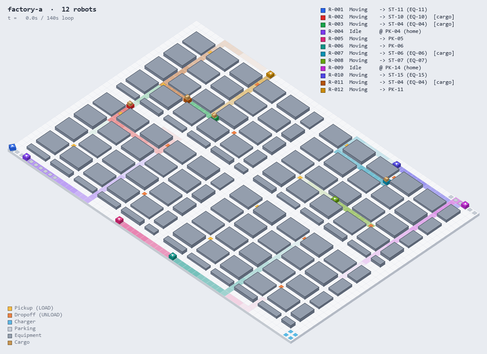
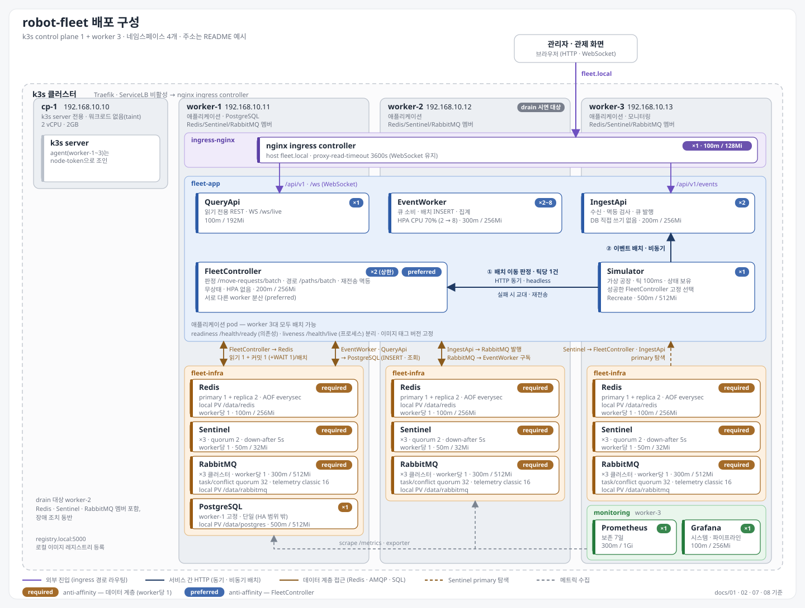

# Robot Fleet

공장 물류 로봇(AMR) 군집을 운영하기 위한 관제 플랫폼.
경로 계획부터 충돌 회피, 교착 해소까지 로봇 운행의 판단을 한곳에서 내리고,
그 과정에서 쌓인 운행 데이터로 "이 공장에 로봇은 몇 대가 적정한가"에 수치로 답한다.

관제 서버는 매 틱 전체 로봇의 이동 요청을 한 번에 받아 승인한다.
데이터 소스는 가상 공장 시뮬레이터이므로, 로봇 대수와 틱 주기만 조정하면
실제 설비 없이도 초당 수만 건 규모까지 부하를 재현할 수 있다.

### 교착 대응 자동화

교착이 발생하면 분석 에이전트가 당시의 대기 그래프, 로봇 궤적, 맵 구조를 근거로 원인을 가려내고
경로 정책의 파라미터 수정안을 근거와 함께 제시한다.
수정안은 허용된 파라미터 안에서만 고르므로 파이프라인이 기계적으로 검증하고, 관리자는 근거를 읽고 승인만 하면 된다.
같은 유형의 교착이 반복될수록 대응 시간은 짧아지고, 판단의 근거는 모두 기록으로 남는다.

<a href="https://raw.githubusercontent.com/hyunpaper/robot-fleet/main/docs/images/fleet-loop-3d.gif"></a>

<details>
<summary>2D 탑뷰</summary>

<a href="https://raw.githubusercontent.com/hyunpaper/robot-fleet/main/docs/images/fleet-loop-2d.gif"></a>

</details>

로봇 12대가 좌하단과 우상단 주차 구역에서 출발해 픽업과 드롭오프를 반복한다. 지나간 칸은 로봇 색으로 물들었다가 서서히 옅어지고, 적재 중인 로봇은 화물 상자를 싣고 이동한다. 같은 칸을 동시에 요청하면 우선순위가 낮은 로봇이 `WAIT` 상태로 양보한다.

---

## 현재 상태

| 단계 | 내용 | 상태 |
|---|---|---|
| M1 | 맵 로드·검증, A* 경로 탐색(회전 비용 포함), 단일 로봇 시뮬레이션 | 완료 |
| M2 | 다중 로봇, 충돌 회피, 교착 탐지·해소 | 충돌 회피 완료, 교착 해소 남음 |
| M3 | Ingest API + RabbitMQ + Worker로 이벤트 파이프라인 분리 | 구현 완료, 실서버 검증 남음 |
| M4 | 락·상태·멱등 키를 Redis로 이전, 관제 서버 2대(재전송 멱등, 장애 조치 감지) | |
| M5 | k3s 노드 3대 배포, nginx ingress, Redis Sentinel·RabbitMQ 3노드, 스케일 아웃 | |
| M6 | Prometheus + Grafana, 실시간 관제 화면, run 재생 데이터 내보내기·정적 재생기 | |
| M7 | 실험(AWS): 로봇 수별 처리량, 회피 전략·우선순위 정책 비교 | |
| M8 | 장애 주입: pod 강제 종료, Redis·브로커 장애 조치, 노드 drain·강제 소실, 네트워크 지연 | |
| M9 | 교착 분석 에이전트: 원인 진단, 정책 파라미터 수정안 생성, 승인 후 자동 배포 | |

### 남은 작업

| 단계 | 할 일 |
|---|---|
| M2 | 대기 그래프 순환 탐지, 회피 지점 양보, 1칸 통로 정면 대치 해소 |
| M3 | 실서버 통합 테스트 41건 실행, 워커 kill·Ingest 재시작 포함 30분 E2E로 유실 0·중복 0 확인 |
| M4 | Redis 이동 판정기(해시 체인 워터마크, 커밋·재주장 Lua), 관제 서버 2대 재전송 멱등, 장애 조치 감지 |
| M5 | 노드 3대 k3s 구성, Redis Sentinel·RabbitMQ 3노드 배포, quorum 멤버 확장 |
| M6 | Prometheus 수집, Grafana 대시보드, 실시간 관제 화면(QueryApi·WebSocket), run 재생 데이터 내보내기와 정적 재생기 |
| M7 | run 전환 기능 뒤 AWS에서 로봇 수별 처리량, 회피 전략·우선순위 정책·통로 폭·혼잡 가중치 비교 실험 |
| M8 | Redis primary·RabbitMQ leader·관제 서버·노드 장애 주입(drain·강제 소실·node-1 API 서버), 겹침 0·유실 0·정지 시간 측정 |
| M9 | 교착 이력 기반 원인 분류(규칙), 로컬 LLM의 정책 파라미터 수정안 생성, 자동 검증 후 승인·배포 파이프라인 |

---

## 구조

```
robot-fleet/
├── src/
│   ├── Shared/                  좌표, 맵, 도메인 모델, 이벤트 계약, 파이프라인 인터페이스
│   ├── FleetController/         A* 경로 계획, 이동 판정
│   ├── Simulator/               틱 루프, 다중 로봇, 작업 생애주기, 이벤트 송신
│   ├── IngestApi/               이벤트 수신, 멱등 검사, 큐 발행 (로직은 Ingest.Core)
│   ├── EventWorker/             파티션 소비, 배치 적재, 집계, 재배정 (로직은 EventWorker.Core)
│   ├── Infrastructure.*/        RabbitMQ, Redis, PostgreSQL 구현
│   ├── Hosting/                 공용 구성, 헬스 체크
│   └── Reconcile/               송신 로그와 적재 결과 대조
├── tests/                       순수 로직 테스트, 실서버 통합 테스트
├── db/migrations/               스키마, 일 단위 파티션
├── maps/                        공장 맵 정의
└── docs/                        설계 문서
```

이후 단계에서 `QueryApi`, `deploy/`, `loadtest/`가 추가된다.

---

## 설계 요약

```
Simulator ──(틱마다 배치 이동 요청)──► FleetController ◄──► Redis   셀 락, 로봇 상태, 대기 그래프
    │
    └──(이벤트 배치)──► IngestApi ──► RabbitMQ ──► EventWorker ──► PostgreSQL
                                                                     ▲
                                                         QueryApi ───┘ ──► 관제 화면 / Grafana
```

자세한 내용은 문서 참고.

| 문서 | 내용 |
|---|---|
| [01-architecture](docs/01-architecture.md) | 서비스 분리, 데이터 흐름, 큐·Redis·DB 설계 |
| [02-infrastructure](docs/02-infrastructure.md) | k3s 구성, 리소스 배분, 모니터링, 장애 주입 |
| [03-map-and-events](docs/03-map-and-events.md) | 맵 포맷, 도메인 모델, 이벤트 스키마, 상태 전이 |
| [04-algorithm](docs/04-algorithm.md) | A*, 충돌 유형, 락 전략, 교착 탐지·해소 |
| [05-metrics](docs/05-metrics.md) | 지표 정의, 실험 설계 |
| [06-m1-design](docs/06-m1-design.md) | M1 상세 설계와 테스트 목록 |
| [07-high-availability](docs/07-high-availability.md) | 관제 서버 2대, Redis Sentinel, RabbitMQ quorum queue, 3노드 분산 |
| [08-ha-detailed-design](docs/08-ha-detailed-design.md) | 해시 체인 워터마크, Lua 규약, Sentinel·큐 설정 값, 노드 배치, 장애 주입 측정 |
| [09-m3-pipeline](docs/09-m3-pipeline.md) | M3 범위, 서비스 경계, 유실 0 증명 방법, 테스트 전략 |
| [10-m3-detailed-design](docs/10-m3-detailed-design.md) | 이벤트 계약, 발행 확인, 워커 배치·배정, 스키마, 테스트 목록, 작업 분할 |

---

## 기술 스택

| 구분 | 사용 |
|---|---|
| 언어 | C# / .NET 8 |
| API · 백그라운드 | ASP.NET Core Minimal API, Worker Service |
| 메시징 | RabbitMQ (RabbitMQ.Client) |
| 상태 · 락 | Redis |
| 저장소 | PostgreSQL |
| 배포 | k3s, nginx ingress |
| 모니터링 | Prometheus, Grafana |
| 부하 테스트 | 시뮬레이터, k6 |

## Core Business

| 과제 | 문제 | 해결 |
|---|---|---|
| **배치 판정** | 200대 개별 요청 시 100ms 틱 초과 | 틱당 1회 일괄 판정, 락·기록을 커밋 Lua 1회로 원자 반영 |
| **충돌 회피** | 동일 칸 진입, 자리 맞바꿈, 추종 | 현재·다음 칸 2칸 선점, 맞바꿈 시 후순위 거부 |
| **기아 방지** | 근거리 우선 시 원거리 작업 적체 | 대기 시간·잔여 거리·긴급도 합산 점수 |
| **교착 해소** | 분산 락 구조상 순환 대기 발생 | 대기 그래프 순환 탐지, 최저 비용 로봇 양보 |
| **판정 정합성** | 장애 조치로 최근 틱 소실 시 이중 승인 | 해시 체인 워터마크, 꼬리 불일치면 판정 거부 후 재주장 |
| **순서 보장** | 완료 이벤트가 시작보다 먼저 처리 | robotId 해시 16파티션, 파티션당 단일 소비자 |
| **멱등 처리** | 재전송 이벤트 유실 또는 중복 집계 | 고정 이벤트 ID, 2단계 키, DB 유니크 제약 |
| **상태 복구** | Redis 초기화·장애 조치 시 칸 점유 소실 | epoch·체인 검사로 감지, Simulator 위치로 맵 해시 재구성 |
| **경로 계획** | 최단 경로의 잦은 회전으로 지연 | 방향 포함 A*, 회전 비용 반영, 1회 0.15ms |
| **효율 측정** | 정지 시간만으로 원인 구분 불가 | 이동·작업·대기·유휴 분해, 병목 위치 특정 |

## 배포 환경 (예정)

자체 서버 또는 클라우드에 k3s 노드 3대로 구성한다. 아래 주소는 예시다.

<a href="https://raw.githubusercontent.com/hyunpaper/robot-fleet/main/docs/images/deployment-ha.svg"></a>

| 노드 | 주소 | 역할 |
|---|---|---|
| node-1 | 10.0.1.11 | k3s server, 애플리케이션, PostgreSQL, Redis·Sentinel·RabbitMQ 멤버 |
| node-2 | 10.0.2.12 | 애플리케이션, Redis·Sentinel·RabbitMQ 멤버 |
| node-3 | 10.0.2.13 | 애플리케이션, 모니터링(실험 시), Redis·Sentinel·RabbitMQ 멤버 |

노드는 기본 4GiB·2 vCPU, 실험 시 8GiB·4 vCPU다. Redis(primary 1 + replica 2 + Sentinel 3)와 RabbitMQ(3노드, quorum queue)는 세 노드에 분산된다. 자세한 내용은 07, 08 문서 참고.
