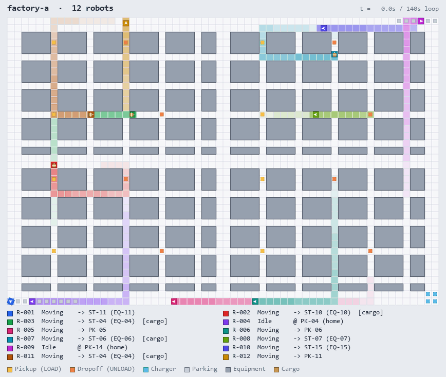

# Robot Fleet

공장 물류 로봇(AMR) 군집을 운영하기 위한 관제 플랫폼.
경로 계획부터 충돌 회피, 교착 해소까지 로봇 운행의 판단을 한곳에서 내리고,
그 과정에서 쌓인 운행 데이터로 "이 공장에 로봇은 몇 대가 적정한가"에 수치로 답한다.

관제 서버는 매 틱 전체 로봇의 이동 요청을 한 번에 받아 승인한다.
데이터 소스는 가상 공장 시뮬레이터이므로, 로봇 대수와 틱 주기만 조정하면
실제 설비 없이도 초당 수만 건 규모까지 부하를 재현할 수 있다.

### 교착 대응 자동화

교착이 발생하면 AI 에이전트가 당시의 대기 그래프, 로봇 궤적, 맵 구조를 근거로 원인을 진단하고
경로 정책이나 레이아웃 수정안을 코드 변경으로 제시한다.
관리자는 진단 보고서와 변경 내역을 검토해 승인만 하면 되고, 이후 검증과 배포는 파이프라인이 이어서 처리한다.
같은 유형의 교착이 반복될수록 대응 시간은 짧아지고, 판단의 근거는 모두 기록으로 남는다.


<details>
<summary>2D 탑뷰</summary>



</details>

로봇이 지나간 칸은 그 로봇의 색으로 칠해진다. 회색 블록은 설비, 바닥색이 다른 칸은 스테이션·충전소·주차 구역이다.

---

## 현재 상태

| 단계 | 내용 | 상태 |
|---|---|---|
| M1 | 맵 로드·검증, A* 경로 탐색(회전 비용 포함), 단일 로봇 시뮬레이션 | 완료 |
| M2 | 다중 로봇, 충돌 회피, 교착 탐지·해소 | 진행 예정 |
| M3 | Ingest API + RabbitMQ + Worker로 이벤트 파이프라인 분리 | |
| M4 | 락·상태·멱등 키를 Redis로 이전, 관제 서버 다중 인스턴스 | |
| M5 | k3s 배포, nginx ingress, 스케일 아웃 | |
| M6 | Prometheus + Grafana, 실시간 관제 화면 | |
| M7 | 실험: 로봇 수별 처리량, 회피 전략·우선순위 정책 비교 | |
| M8 | 장애 주입: pod 강제 종료, 브로커 재시작, 네트워크 지연 | |
| M9 | 교착 분석 에이전트: 원인 진단, 수정안 생성, 승인 후 자동 배포 | |

> 위 GIF는 M1 단계 결과물이다. 아직 충돌 회피가 없어서, 경로가 같은 시각에 겹치지 않도록 출발지와 목적지를 골라 돌렸다.

---

## 구조

```
robot-fleet/
├── src/
│   ├── Shared/            좌표, 맵 로더·검증, 도메인 모델
│   ├── FleetController/   A* 경로 계획, 이동 승인
│   └── Simulator/         틱 루프, 로봇 이동, 콘솔 출력
├── tests/                 xUnit 테스트 (Shared / FleetController / Simulator)
├── tools/                 트레이스 내보내기, GIF 렌더러
├── maps/
│   ├── factory-a.json     60×40 공장 맵
│   └── test-corridor.json 9×7 테스트 맵 (1칸 통로)
└── docs/                  설계 문서
```

이후 단계에서 `IngestApi`, `EventWorker`, `QueryApi`, `deploy/`, `loadtest/`가 추가된다.

---

## 설계 요약

```
Simulator ──(틱마다 배치 이동 요청)──► FleetController ◄──► Redis   셀 락, 로봇 상태, 대기 그래프
    │
    └──(이벤트 배치)──► IngestApi ──► RabbitMQ ──► EventWorker ──► PostgreSQL
                                                                     ▲
                                                         QueryApi ───┘ ──► 관제 화면 / Grafana
```

- **이동 승인은 동기, 이벤트 적재는 비동기.** 로봇이 움직여도 되는지는 즉답이 필요하고, DB 적재가 느려져도 로봇은 멈추면 안 된다.
- **배치 이동 판단.** 로봇 200대가 각각 HTTP를 보내면 100ms 틱을 맞출 수 없어서 틱당 한 번에 묶어 판정한다.
- **분산 락 + 교착 해소.** 현재 칸과 다음 칸을 함께 잠가 자리 맞바꿈 충돌을 막고, 대기 그래프에서 순환을 찾아 한 대를 비켜 세운다.
- **순서 보장.** `robotId` 기준 consistent hash로 파티션을 나누고 파티션마다 consumer를 하나만 둔다.
- **멱등.** 이벤트 ID를 `{batchId}/{index}`로 고정해서 재전송해도 같은 값이 되게 하고, Ingest와 Worker 양쪽에서 거른다.
- **시간 분해.** 로봇의 시간을 이동, 작업, 대기, 유휴로 나눈다. 대기(길이 막힘)와 유휴(할 일 없음)를 구분해야 병목이 로봇 수인지 통로인지 알 수 있다.

자세한 내용은 문서 참고.

| 문서 | 내용 |
|---|---|
| [01-architecture](docs/01-architecture.md) | 서비스 분리, 데이터 흐름, 큐·Redis·DB 설계 |
| [02-infrastructure](docs/02-infrastructure.md) | k3s 구성, 리소스 배분, 모니터링, 장애 주입 |
| [03-map-and-events](docs/03-map-and-events.md) | 맵 포맷, 도메인 모델, 이벤트 스키마, 상태 전이 |
| [04-algorithm](docs/04-algorithm.md) | A*, 충돌 유형, 락 전략, 교착 탐지·해소 |
| [05-metrics](docs/05-metrics.md) | 지표 정의, 실험 설계 |
| [06-m1-design](docs/06-m1-design.md) | M1 상세 설계와 테스트 목록 |

---

## 기술 스택

| 구분 | 사용 |
|---|---|
| 언어 | C# / .NET 8 |
| API · 백그라운드 | ASP.NET Core Minimal API, Worker Service |
| 메시징 | RabbitMQ (MassTransit) |
| 상태 · 락 | Redis |
| 저장소 | PostgreSQL |
| 배포 | k3s, nginx ingress |
| 모니터링 | Prometheus, Grafana |
| 부하 테스트 | 시뮬레이터, k6 |

## 배포 환경 (예정)

자체 서버에 k3s 3노드로 구성한다. 아래 주소는 예시다.

| 노드 | 주소 | 역할 |
|---|---|---|
| node-1 | 192.168.10.11 | control plane, PostgreSQL, RabbitMQ |
| node-2 | 192.168.10.12 | 애플리케이션 |
| node-3 | 192.168.10.13 | 애플리케이션, 모니터링 |
