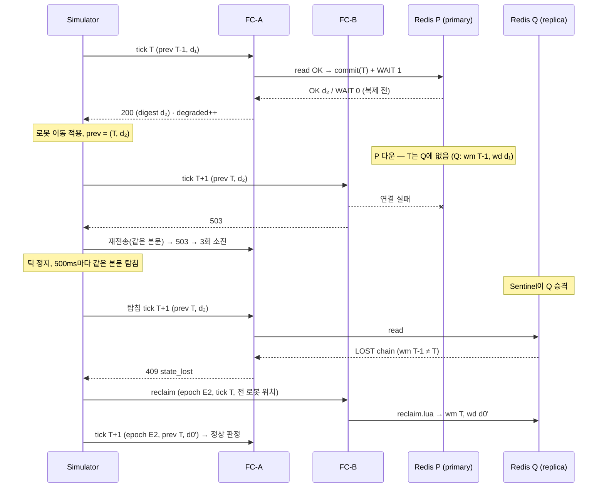
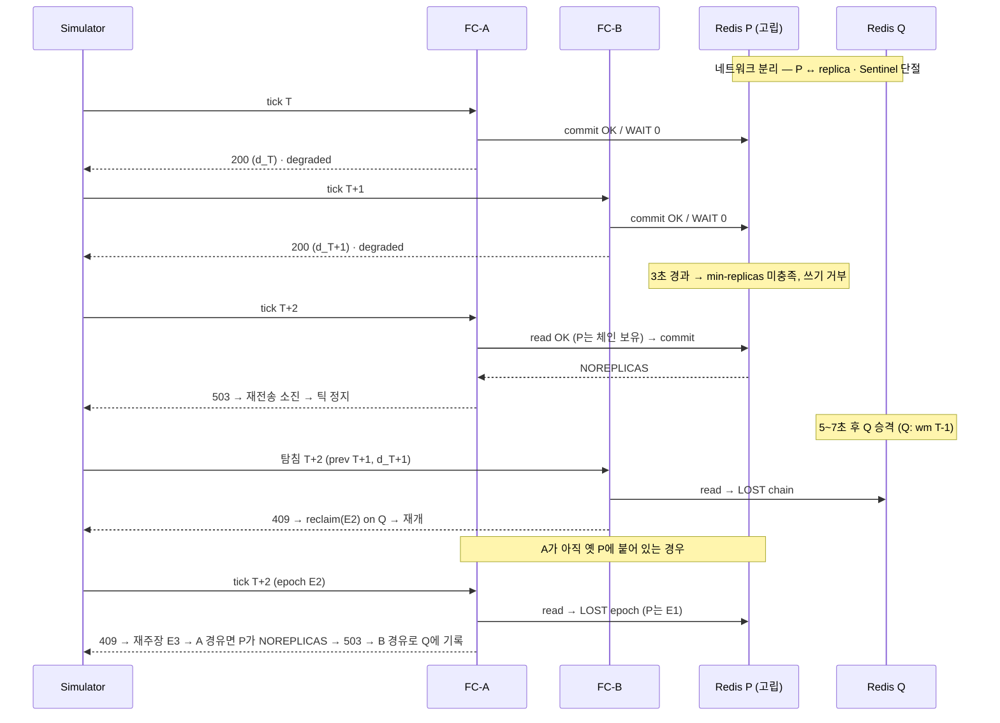

# 08. 고가용성 상세 설계

07의 큰 틀 아래 위임 항목 1~13을 채운다. 설정 값마다 근거를 한 줄로 붙인다.
측정으로 확정해야 하는 값은 "M4 측정" 또는 "M8 측정"으로 표시한다.

---

## 07 대비 변경점

07의 제약을 바꾼 곳이다. 나머지는 07을 그대로 따른다.

| # | 07 원문 | 08 결정 | 근거 |
|---|---|---|---|
| C1 | 장애 조치 = 상태 소실로 취급. 감지하면 항상 `409` | **해시 체인 워터마크 검증.** 새 primary가 Simulator가 적용한 마지막 판정까지 갖고 있으면 그대로 진행, 하나라도 빠졌거나 갈라졌으면 `409` | 복제는 primary 쓰기 순서의 접두사다. 마지막 판정의 다이제스트가 일치하면 그 이전 상태도 전부 일치한다(아래 "불변식"). 손실 여부를 정확히 알 수 있으므로 "항상 409"보다 엄격하고, 불필요한 재주장이 없다 |
| C2 | `WAIT 1`은 감지 창의 2차 안전망 | `WAIT 1`은 **안전성과 무관**. 장애 조치 뒤 재주장 빈도를 줄이는 장치 | 감지 창의 이중 승인은 체인 검증이 막는다. WAIT 실패는 "이 틱이 복제됐는지 모름"일 뿐이고, 다음 틱의 체인 검증이 그 답을 낸다 |
| C3 | 재전송 기록 키 `(mapId, tick)`, TTL 수 틱 | 맵 해시 안에 **최신 1틱 기록만** 둔다. 다음 틱 커밋이 덮어쓴다 | Simulator는 응답을 받기 전에 다음 틱을 보내지 않고, 다음 틱을 보낸 뒤에는 이전 틱을 다시 보내지 않는다. 기록 = 워터마크가 되어 별도 TTL 조정이 필요 없다 |
| C4 | (01) Redis 왕복 배치당 1회(Lua) | 배치당 **2회**: 읽기 Lua 1 + 커밋 Lua 1(`WAIT`는 커밋과 파이프라인) | 판정 기록에 교착 해소 결과까지 넣어야 락과 같은 원자 단위가 된다. 교착 탐지는 락 결과를 본 뒤에야 가능하므로 "읽기 → 메모리 판정 → 원자 커밋"으로 나눈다 |
| C5 | (01) 칸별 락 키, 논리 20틱 + 실시간 TTL 만료 | 맵당 **단일 해시**, 칸별 만료 폐지. 해제는 명시적으로만 | 기존 규칙에 결함 두 개: ① 이동 요청을 보내지 않는 정지 로봇(Idle·Loading)의 칸 락이 20틱 뒤 만료되어 다른 로봇이 그 칸을 승인받는다. ② 틱 정지가 실시간 TTL(배속 1에서 2초)보다 길면 칸 락이 일부만 사라져 구멍이 생긴다. 단일 키는 통째로만 만료되므로 구멍이 생기지 않는다 |
| C6 | 틱마다 로드밸런서가 임의 인스턴스로 | **headless Service + Simulator 측 선택.** 틱마다 교대, 재전송은 실패한 인스턴스를 제외 | ClusterIP는 HTTP keep-alive 연결 하나에 고정되어 교대가 안 되고, 재전송이 같은 죽은 pod로 갈 수 있다. cp-1 다운 시 endpoint 갱신이 멈춰 죽은 pod가 Service에 남는다 |
| C7 | (01) Ingest 멱등 키 실패 처리 없음 | Redis 오류 시 1단계를 **건너뛰고 발행**(fail-open) | 07 정합성 원칙에서 `idem:*`은 유실 허용, 중복은 워커가 막는다. Redis 장애 조치(최대 30초) 동안 이벤트 파이프라인을 세울 이유가 없다 |

---

## 핵심 장치 — 해시 체인 워터마크

위임 항목 3(감지)과 4(재전송 멱등)는 같은 장치로 푼다.

### 맵 상태 단일 해시

판정 안전에 필요한 상태는 전부 `fleet:map:{mapId}` 해시 하나에 둔다.

| 필드 | 값 | 역할 |
|---|---|---|
| `epoch` | Simulator가 발급한 세대 id | 재주장마다 바뀐다. 기존 `fleet:epoch:{mapId}` 대체 |
| `wm` | 마지막으로 커밋된 tick | 워터마크 |
| `wd` | 마지막 커밋의 다이제스트 | 체인 꼬리 |
| `wd0` | 재주장 시점의 다이제스트(체인 뿌리) | 재주장 재요청 응답 |
| `rh` | 마지막 커밋 요청 본문의 해시 | 같은 tick 재요청 판별 |
| `rec` | 마지막 커밋의 응답 본문(JSON) | 재요청에 그대로 반환 |
| `rch` | 재주장 요청 본문의 해시 | 재주장 멱등 |
| `c:{x}:{y}` | `{robotId}:{tick}` | 칸 점유. 값의 tick은 진단용 |
| `r:{robotId}` | `{x},{y}` 또는 `{x},{y};{tx},{ty}` | 로봇 현재 칸과 이동 중 목표 칸 |
| `wg` | JSON `{robotId: "blockedBy:tick"}` | 대기 그래프 (04). 50틱 지난 항목은 무시 |
| `dl` | JSON `{cycleKey: "tick:yieldRobotId:x,y"}` | 교착 해소 결정 (04). 50틱 |
| `yl` | JSON `{robotId: tick}` | 양보 중 표시 (04). 50틱 |

| 결정 | 근거 |
|---|---|
| 키 TTL `30s`, 커밋마다 갱신 | 칸 단위 만료를 없앴으므로 TTL은 버려진 맵 정리용이다. 30초 넘게 틱이 멈췄다면 이미 07 예산 초과이므로 통째로 만료시키고 재주장으로 시작하는 편이 깔끔하다 |
| 한 키에 모두 | 두 키에 나누면 만료 시점이 달라 "워터마크는 있는데 락은 없는" 상태가 생긴다. 단일 키는 있거나 없거나 둘 중 하나 |
| `robot:state`, `metrics:*`, `idem:*`는 밖에 둔다 | 판정 안전과 무관한 캐시다. 소실돼도 겹침이 생기지 않는다 |

### 다이제스트 체인

```
d0 = sha1(epoch ‖ 재주장 본문 해시)                     -- 재주장이 뿌리를 만든다
dT = sha1(d(prev) ‖ 응답 본문 T)                        -- 커밋마다 한 고리
```

요청은 `prev = {tick, digest}`(Simulator가 마지막으로 **적용한** 판정)를 싣고, 응답은 새 `digest`를 돌려준다.

### 커밋 조건 (커밋 Lua 안에서 원자 검사)

| # | 조건 | 실패 시 |
|---|---|---|
| 1 | 키가 있고 `epoch` 일치 | `409 state_lost` (`missing` / `epoch`) |
| 2 | `wm == tick`이면 재요청: `rh` 일치 → 기록 반환, 불일치 → 거부 | `409 batch_mismatch` |
| 3 | `wm == prev.tick` 이고 `wd == prev.digest` | `409 state_lost` (`chain`) |
| 4 | 쓰려는 칸 필드가 읽기 단계에서 본 값과 같다 (방어 검사) | `409 state_lost` (`conflict`) |

### 불변식

> **저장소 X가 tick T를 커밋할 수 있다 ⇔ X의 체인 꼬리가 Simulator가 적용한 마지막 판정과 같다.**
> 고리마다 직전 꼬리를 검사하고 들어갔으므로 꼬리가 같으면 뿌리(재주장)부터 전체 이력이 같다.
> 즉 X의 칸 점유 = Simulator의 실제 위치. 그 위에서 내린 판정은 겹침을 만들 수 없다.

| 경우 | 꼬리 | 결과 |
|---|---|---|
| 새 primary가 마지막 틱까지 복제받음 | 일치 | 그대로 진행. 정지는 장애 조치 시간뿐 |
| 마지막 틱(들)이 복제 전에 primary가 죽음 | `wm`이 뒤처짐 | `409 chain` → 재주장 |
| 분리된 옛 primary와 새 primary가 같은 tick을 각각 커밋 (아래 시퀀스 B) | 다이제스트가 다름 | Simulator가 받지 않은 쪽은 영원히 `409` |
| Redis 재시작으로 빈 상태 / `FLUSHDB` | 키 없음 | `409 missing` → 재주장 (01 기존 절차와 동일) |
| 두 저장소에서 우연히 같은 판정이 나옴 | 일치 | 상태가 실제로 같으므로 안전 |

---

## 1. Sentinel · Redis 설정 값

### Sentinel

| 설정 | 값 | 근거 |
|---|---|---|
| `sentinel monitor fleet <master> 6379 2` | quorum 2 | 07. 3개 중 1개 손실까지 합의 |
| `down-after-milliseconds` | **5000** | 오탐 방어 우선. VM CPU steal · AOF rewrite fork · 노드 네트워크 순간 지연은 1~2초 안쪽이다. 5초면 여유 2배 이상이고 30초 예산에서 감당된다(아래 타임라인) |
| `failover-timeout` | **6000** | 선출 분열 시 재시도 간격이 `2 × failover-timeout` = 12초. 이 값이 최악 경로를 30초 안에 묶는다. 승격 자체는 1초 안이라 6초는 중단 위험이 없다 |
| `parallel-syncs` | 1 | 승격 후 남는 replica가 1대뿐이라 값의 효과가 없다. 기본값 유지 |
| `resolve-hostnames` / `announce-hostnames` | yes | pod IP가 재시작마다 바뀐다. headless DNS 이름으로 알린다 |

### Redis

| 설정 | 값 | 근거 |
|---|---|---|
| 버전 | 7.2 | shebang 플래그(`no-writes`), 스크립트 효과 복제(MULTI/EXEC로 감싸 복제 → replica에서도 원자) |
| `min-replicas-to-write` | 1 | 07. 고립된 옛 primary 쓰기 차단 |
| `min-replicas-max-lag` | **3** | `down-after`(5초)보다 짧아야 옛 primary가 새 primary 승격 **전에** 스스로 쓰기를 멈춘다. replica ACK는 1초 주기 |
| `appendonly` / `appendfsync` | yes / everysec | `down-after` 안에 재시작된 primary가 빈 채로 떠서 replica까지 비우는 사고를 줄인다. 정합성은 체인이 맡으므로 1초 유실은 무방 |
| `save` | `""` | RDB fork 불필요 |
| `repl-diskless-sync` / `-delay` | yes / **0** | 기본 지연 5초가 장애 조치 후 전체 재동기화를 그만큼 늦춘다. 30초 예산에서 뺀다 |
| `maxmemory` / 정책 | 192mb / `noeviction` | 맵 해시를 축출하면 안 된다. 메모리 limit 512Mi에서 AOF rewrite fork 여유를 남긴다 |
| `hz` | **100** | 블로킹 명령(`WAIT`) 타임아웃 검사가 서버 주기에 묶인다. 기본 10이면 최대 100ms 늦을 수 있다. 100이면 10ms (M4 측정) |
| `auto-aof-rewrite-min-size` | 64mb | 틱마다 `rec`(약 15KB)를 덮어써 AOF가 빨리 자란다. 데이터 자체는 1MB 미만이라 rewrite가 싸다 |

---

## 2. 판정 경로와 `WAIT 1`

### 배치 1건의 처리

| 단계 | Redis 왕복 | 내용 |
|---|---|---|
| ① 읽기 | 1 | `read.lua` — 커밋 조건 1~3 검사, 재요청이면 기록 반환(여기서 끝). 아니면 요청·해제 로봇의 `c:` · `r:` 필드와 `wg` · `dl` · `yl` 반환 |
| ② 메모리 판정 | 0 | 해제 적용 → 01 "배치 내 판정 순서" 1~3단계 → 대기 그래프 갱신 → 교착 탐지·해소(04). 결과: 응답 본문 + 필드 변경 목록(diff) |
| ③ 커밋 | 1 | `commit.lua` (조건 1~4 재검사 → diff 적용 → `wm`·`wd`·`rh`·`rec` 기록) **와 `WAIT 1 5`를 같은 연결에 파이프라인** |

### p99 10ms 예산

가정: worker 간 왕복 p99 ≤ 1ms (같은 L2 대역), 200대 기준 Lua 실행 ≤ 0.5ms. 둘 다 M4 측정.

| 구간 | 정상 p99 | WAIT 타임아웃 시 |
|---|---|---|
| ① 읽기 (왕복 1 + 실행) | 1.5ms | 1.5ms |
| ② 메모리 판정 (정렬 · 점유 · 교착) | 1.0ms | 1.0ms |
| ③ 커밋 (왕복 1 + 실행) | 1.5ms | 1.5ms |
| ③ `WAIT` 대기 (replica ACK 왕복) | 1.0ms | **5.0ms** (타임아웃) |
| 직렬화 · HTTP 처리 | 0.5ms | 0.5ms |
| **합계** | **5.5ms** | **9.5ms** |

> 타임아웃을 넣고도 10ms 안이다. M4 측정에서 왕복이 가정보다 크면 WAIT 타임아웃을 3ms로 내린다.
> 내려도 바뀌는 건 degraded 빈도뿐이다(C2).

| 결정 | 근거 |
|---|---|
| `WAIT`는 커밋과 **같은 연결**에서 | `WAIT`는 그 연결의 마지막 쓰기 오프셋을 기다린다. 다른 연결에서 부르면 즉시 0을 기다리고 끝난다 |
| 커밋 전용 연결 2개(풀), 판정 경로 외 사용 금지 | `WAIT` 중인 연결은 서버에서 막혀 뒤 명령이 줄을 선다. 공용 멀티플렉서에 섞으면 다른 명령이 최대 타임아웃만큼 밀린다 |
| 클라이언트 가드: 커밋 응답은 20ms, `WAIT` 응답은 배치 시작부터 9ms까지만 기다린다 | 서버 타임아웃이 늦게 와도 판정 응답이 밀리지 않게. 가드에 걸린 연결은 응답이 올 때까지 풀에서 뺀다 |

### `WAIT` 결과별 동작

| 결과 | 판정 응답 | 메트릭 |
|---|---|---|
| ≥ 1 | 200 | — |
| 0 (타임아웃) 또는 가드 초과 | **200, 승인 유효** | `fleet_redis_wait_degraded_total{map_id}` |
| 커밋 응답 자체를 못 받음 | 503 | 커밋 여부를 모르므로 재전송에 맡긴다. 재전송은 기록 반환 또는 새 커밋 중 하나로 수렴(§4) |
| 커밋이 `NOREPLICAS` / `READONLY` | 503 | §7 재연결 트리거 |

**연속 실패 시 `state_lost`로 보내지 않는다.** 판정은 권위 있는 primary의 전체 상태 위에서 내려졌으므로 불확실한 것은
"이 틱의 내구성"뿐이고, 그 답은 다음 틱의 체인 검사가 낸다. 같은 primary에 재주장해 봐야 쓰는 곳이 같아 안전이 늘지 않고
틱만 멈춘다. 대신 `min-replicas-max-lag 3`이 고립 primary를 3초 안에 쓰기 거부로 만들고, 알림을 건다.

```yaml
- alert: RedisReplicationDegraded
  expr: rate(fleet_redis_wait_degraded_total[1m]) / rate(fleet_move_batches_total[1m]) > 0.5
  for: 30s
```

---

## 3. 장애 조치 감지

### 감지 수단

| 순위 | 수단 | 위치 | 쓰임 |
|---|---|---|---|
| 1 | 체인 검사 (`read.lua` · `commit.lua`) | 판정 경로, **배치마다** | 유일한 안전 장치. 손실·분기를 `409`로 바꾼다 |
| 2 | 연결 오류 · `READONLY` · `NOREPLICAS` | 판정 경로 | 503 + Sentinel 재질의(§7) |
| 3 | Sentinel `+switch-master` 구독 | 백그라운드 | 재연결을 앞당기고 `fleet_redis_failover_total`을 올린다. **판정에 쓰지 않는다** |

`409` 이후는 01 "Redis 상태 소실 복구" 그대로다. 새 `epoch`는 Simulator가 발급하고, 재주장 tick은 **마지막으로 적용한 tick**이다
(멈춘 틱은 아직 판정 전이므로). 재주장 직후 첫 배치는 `prev = {재주장 tick, d0}`.

### 감지 → 재개 30초 타임라인 (Redis primary pod 강제 종료)

| 단계 | 일반 | 최악 | 근거 |
|---|---|---|---|
| SDOWN | 5.0s | 5.0s | `down-after-milliseconds` |
| ODOWN 합의 | 0.5s | 1.0s | Sentinel 상호 질의 1초 주기 |
| 리더 선출 | 0.5s | 1.0s + **12.0s** + 1.0s | 무작위 지연 ≤ 1초. 표 분열 1회 시 `2 × failover-timeout` 후 재시도 |
| 승격 확인 | 1.0s | 2.0s | 승격 replica `INFO` 1초 주기 |
| 남은 replica 재연결 (`min-replicas-to-write` 충족) | 0.5s | 2.0s | PSYNC2 부분 재동기화. 실패해도 diskless · delay 0 |
| FleetController 재연결 | 0.3s | 2.0s | `+switch-master` 즉시 또는 오류 시 재질의(250ms 간격) |
| Simulator 탐침 대기 | 0.25s | 0.5s | 탐침 주기 500ms (§5) |
| 체인 불일치 → `409` → 재주장 → 재개 | 0.01s | 0.2s | 왕복 3회 |
| **합계** | **약 8s** | **약 27s** | 30초 이내 |

> 표 분열이 두 번 나면 30초를 넘는다. 남은 Sentinel 2개가 동시에 출마해야 일어나는 일이라 무작위 지연으로 드물다.
> M8에서 `+failover-end` 까지의 분포를 기록하고, 넘으면 `failover-timeout`을 5000으로 내린다.

### 시퀀스 A — primary 다운, 마지막 틱 미복제



> Q 위에서 T+1이 판정되는 길은 재주장 뒤 하나뿐이고, 재주장은 Simulator의 실제 위치로 칸을 채운다.
> T의 락이 없는 Q 위에서 내려진 승인은 존재하지 않는다.

### 시퀀스 B — 감지 전 1~2틱 (primary 고립, 애플리케이션은 계속 닿음)



| 창 | 승인이 내려진 상태 | 겹침 가능성 |
|---|---|---|
| T, T+1 (감지 전) | P — Simulator가 적용한 모든 판정을 가진 유일한 저장소 | 없음. 정상 판정과 같다 |
| T+1 이후 ~ Q 승격 | 어디서도 커밋 불가 (P는 `NOREPLICAS`, Q는 replica) | 없음. 틱 정지 |
| Q 승격 후 | Q — T, T+1을 모름 | 체인 불일치로 판정 자체가 불가. 재주장 뒤에만 판정 |
| 분리 해소 전 P | 옛 `epoch` | `epoch` 불일치 + 쓰기 거부 |

**분리 비대칭 사례** — P가 replica 하나를 데리고 고립되면(`{P, R1}` | `{Q, R2, Sentinel 2}`) P는 계속 쓰기를 받는다.
FC-A는 P, FC-B는 Q에 붙은 채로 같은 tick을 각각 커밋할 수 있다. Simulator가 받은 쪽의 다이제스트만 다음 `prev`가 되므로
다른 쪽은 그 tick 이후 영원히 `409`다. 결과는 재주장 핑퐁(진행 정지)이지 겹침이 아니다. 진행은 분리가 풀려 Sentinel이
P를 replica로 내릴 때 회복된다. **안전은 보장, 진행은 미보장** — 07 "멈춤은 허용, 겹침은 불허"에 맞는다.

---

## 4. 재전송 멱등 Lua 규약

### 스크립트

`read.lua` — 쓰기 없음. 재요청이면 여기서 기록을 돌려주고 끝난다.

```lua
#!lua flags=no-writes
-- KEYS[1] = fleet:map:{mapId}
-- ARGV[1] epoch  ARGV[2] tick  ARGV[3] prevTick  ARGV[4] prevDigest  ARGV[5] reqHash
-- ARGV[6..] 판정에 필요한 필드 (요청 · 해제 로봇의 c:x:y, r:robotId)
local k = KEYS[1]
local m = redis.call('HMGET', k, 'epoch', 'wm', 'wd', 'rh', 'rec', 'wg', 'dl', 'yl')
if not m[1] then return {'LOST', 'missing'} end
if m[1] ~= ARGV[1] then return {'LOST', 'epoch'} end
if m[2] == ARGV[2] then
  if m[4] == ARGV[5] then return {'DONE', m[5], m[3]} end
  return {'MISMATCH'}
end
if m[2] ~= ARGV[3] or m[3] ~= ARGV[4] then return {'LOST', 'chain'} end
local vals = {}
if #ARGV >= 6 then vals = redis.call('HMGET', k, unpack(ARGV, 6, #ARGV)) end
return {'OK', m[6] or '', m[7] or '', m[8] or '', vals}
```

`commit.lua` — **락 획득과 판정 기록이 같은 스크립트**. 모든 검사를 첫 쓰기 전에 끝낸다(Lua는 롤백이 없다).

```lua
#!lua
-- KEYS[1] = fleet:map:{mapId}
-- ARGV[1] epoch  ARGV[2] tick  ARGV[3] prevTick  ARGV[4] prevDigest  ARGV[5] reqHash
-- ARGV[6] 응답 본문(JSON)  ARGV[7] ttlMs  ARGV[8] nGuard  ARGV[9] nDel
-- 이어서 guard 2×nGuard (필드, 읽기 단계에서 본 값 — 없으면 "")
--       del   nDel     (필드)
--       set   나머지    (필드, 값) 쌍
local k = KEYS[1]
local m = redis.call('HMGET', k, 'epoch', 'wm', 'wd', 'rh', 'rec')
if not m[1] then return {'LOST', 'missing'} end
if m[1] ~= ARGV[1] then return {'LOST', 'epoch'} end
if m[2] == ARGV[2] then
  if m[4] == ARGV[5] then return {'DONE', m[5], m[3]} end    -- 경쟁한 다른 인스턴스가 먼저 커밋
  return {'MISMATCH'}
end
if m[2] ~= ARGV[3] or m[3] ~= ARGV[4] then return {'LOST', 'chain'} end

local nGuard, nDel = tonumber(ARGV[8]), tonumber(ARGV[9])
local i = 10
for _ = 1, nGuard do
  local v = redis.call('HGET', k, ARGV[i]) or ''
  if v ~= ARGV[i + 1] then return {'CONFLICT', ARGV[i], v} end
  i = i + 2
end
-- 여기부터 쓰기. 이후 실패 분기 없음
if nDel > 0 then redis.call('HDEL', k, unpack(ARGV, i, i + nDel - 1)) end
i = i + nDel
local digest = redis.sha1hex(ARGV[4] .. '\n' .. ARGV[6])
redis.call('HSET', k, 'wm', ARGV[2], 'wd', digest, 'rh', ARGV[5], 'rec', ARGV[6],
           unpack(ARGV, i, #ARGV))
redis.call('PEXPIRE', k, ARGV[7])
return {'OK', digest}
```

`reclaim.lua` — 같은 `epoch` 재요청은 무변경.

```lua
#!lua
-- KEYS[1] = fleet:map:{mapId}
-- ARGV[1] epoch  ARGV[2] tick(마지막 적용 tick)  ARGV[3] 본문 해시  ARGV[4] ttlMs
-- ARGV[5..] (필드, 값) 쌍 — 로봇마다 c:현재칸, (이동 중이면) c:다음칸, r:robotId
local k = KEYS[1]
local m = redis.call('HMGET', k, 'epoch', 'rch', 'wd0')
if m[1] == ARGV[1] then
  if m[2] == ARGV[3] then return {'DONE', m[3]} end
  return {'MISMATCH'}
end
local root = redis.sha1hex(ARGV[1] .. '\n' .. ARGV[3])
redis.call('DEL', k)
redis.call('HSET', k, 'epoch', ARGV[1], 'wm', ARGV[2], 'wd', root, 'wd0', root,
           'rch', ARGV[3], 'rh', '', 'rec', '', unpack(ARGV, 5, #ARGV))
redis.call('PEXPIRE', k, ARGV[4])
return {'OK', root}
```

| 규약 | 내용 | 근거 |
|---|---|---|
| 요청 해시 | `sha256(canonical(mapId, tick, epoch, prev, requests, releases))` 앞 16바이트 hex | JSON 공백 · 필드 순서와 무관하게 같은 의미면 같은 해시 |
| `lockToken` | `{robotId}:{tick}` — 난수 없음 | 재판정해도 토큰이 같다. 해제 검증은 커밋 Lua의 guard가 대신한다 |
| 해제 | `ReleaseAsync`는 즉시 보내지 않고 **다음 배치의 `releases`** 에 싣는다 | 해제도 같은 원자 커밋 · 같은 체인에 들어간다. 별도 쓰기가 없으니 체인 밖 상태가 없다 |
| `From` 불일치 | `r:` 의 현재 칸 ≠ 요청 `From` → `409 state_lost(from_mismatch)` | 불확실하면 정지 |
| 응답 매핑 | `OK`/`DONE` → 200, `LOST`·`CONFLICT` → 409 `state_lost`, `MISMATCH` → 409 `batch_mismatch`, Redis 오류 → 503 | Simulator는 `batch_mismatch`도 재주장으로 처리한다(본문이 바뀐 재전송은 버그) |
| 스크립트 적재 | 기동 시 `SCRIPT LOAD`, `NOSCRIPT`면 1회 재적재 후 재시도 | 장애 조치 후 새 primary에는 스크립트 캐시가 없다 |

### 첫 처리 중 인스턴스가 죽는 모든 시점

FC-A가 tick T를 처리하다 죽거나 멈추고, Simulator가 같은 본문을 FC-B로 재전송한다.
"동일"의 정의: **Simulator가 적용하는 판정은 틱당 정확히 하나이고, Redis의 기록과 같다.**

| # | FC-A가 멈춘 시점 | Redis | FC-B 경로 | Simulator가 적용 | 동일 |
|---|---|---|---|---|---|
| 1 | 읽기 전 | 변화 없음 | read OK → 판정 → commit OK | D_B | ✓ 존재하는 판정은 D_B뿐 |
| 2 | 읽기 후 · 커밋 전송 전 | 변화 없음 | 1과 같음 | D_B | ✓ |
| 3 | 커밋 전송 중 (Redis 미수신) | 변화 없음 | 1과 같음 | D_B | ✓ |
| 4 | 커밋 실행 후 · `WAIT` 응답 전 | `wm=T`, `rec=D_A` | read → `DONE` | D_A | ✓ |
| 5 | `WAIT` 후 · HTTP 응답 전 | 4와 같음 | read → `DONE` | D_A | ✓ |
| 6 | HTTP 응답 송신 후 유실 · Simulator 시도 타임아웃 후 도착 | 4와 같음 | read → `DONE` | D_A (늦은 응답은 폐기, 어차피 D_A) | ✓ |
| 7 | 멈췄다 살아남, FC-B가 먼저 커밋 | `rec=D_B` | — | D_B. FC-A의 commit은 `DONE(D_B)`를 받는다 | ✓ |
| 8 | 멈췄다 살아남, FC-A 커밋이 FC-B 읽기와 커밋 사이 | `rec=D_A` | commit → `DONE(D_A)` | D_A | ✓ |
| 9 | 4~6 직후 primary도 다운, T 미복제 | 새 primary `wm=T-1` | 장애 조치 후 read OK → 새 판정 | D_B. D_A는 아무도 적용하지 않음 | ✓ |
| 10 | D_A가 Simulator에 적용된 뒤 primary 다운 | 새 primary `wm=T-1` | 재전송 없음. T+1에서 `chain` → 재주장 | — | ✓ |

> 9번에서 D_A와 D_B가 다를 수 있지만 D_A는 관측되지 않았다. 07의 "같은 입력에 다른 판정 불가"는
> **관측된 판정이 바뀌지 않는다**로 해석한다. 관측된 판정(10번)은 체인 때문에 절대 뒤집히지 않는다.

### 교착 해소 락(04)과의 상호작용

| 04 장치 | M4 이후 | 근거 |
|---|---|---|
| `deadlock:resolve:{mapId}:{cycleKey}` `SET NX` | 맵 해시 `dl` 필드. 커밋 Lua 안에서만 기록 | 판정 기록과 같은 원자 단위가 된다 |
| 04 경합 (a) "재전송으로 다른 pod가 같은 틱 재처리" | **재탐지 자체가 없다.** 재전송은 기록 반환(4~8번) 또는 아무것도 커밋되지 않은 상태에서의 첫 처리(1~3번) | 같은 tick에 해소 결정이 두 번 커밋될 길이 없다 |
| "두 번째 발견자는 값을 읽어 같은 결정" | 유지. ② 메모리 판정이 `dl`에 살아 있는(50틱 이내) 해소가 있으면 새로 정하지 않고 그 결정을 쓴다 | 다음 틱에 같은 순환을 다시 봐도 양보 로봇이 바뀌지 않는다 |
| `robot:yielding:{robotId}` TTL 50틱 | `yl` 필드, tick 비교로 50틱 | 실시간 TTL 제거 (C5) |
| 해소 완료 시 락 삭제 | 커밋 diff로 `dl` · `yl` 항목 제거 | |
| 04 경합 (b) M8 이후 백그라운드 탐지기 | **도입하려면 같은 커밋 조건(체인)을 거쳐야 한다.** 별도 쓰기 경로 금지 | 체인 밖 쓰기가 생기면 불변식이 깨진다 |

---

## 5. Simulator 재전송 정책

| 항목 | 값 | 근거 |
|---|---|---|
| 시도 타임아웃 | **100ms** | 판정 p99 10ms의 10배. 배속 1에서 1틱 |
| 시도 횟수 | **3** (최초 1 + 재시도 2) | 두 인스턴스에 각 1회 이상 + 1회 여유. 소진까지 최대 약 320ms |
| 백오프 | 0ms → 20ms | 첫 재시도는 다른 인스턴스로 즉시 |
| 대상 선택 | 틱마다 교대. 재시도는 **직전 실패 인스턴스 제외** | C6. headless Service DNS를 2초마다 갱신, 실패 시 마지막 목록 유지 |
| 재시도 대상 오류 | 타임아웃, 연결 실패, 503 | 409는 재시도하지 않는다 → 재주장 |
| 소진 시 | **틱 정지.** 500ms마다 같은 본문으로 탐침 | 30초 예산에서 탐침 지연 ≤ 0.5초 |
| 409 | 재주장(`epoch` 새로 발급) → 성공 시 같은 tick을 새 `epoch` · `prev`로 판정 | 01 복구 절차 |
| 재주장 재시도 | 같은 `epoch` 본문으로 500ms마다 | 재주장 Lua가 멱등 |
| 불변 | `tick`, `epoch`, `prev`, `requests`, `releases`, 이벤트 배치 `batchId` | 직렬화한 본문 바이트를 그대로 재사용 |
| 늦은 응답 | 취소된 시도의 응답은 버린다 | 틱당 적용되는 응답은 정확히 1개 |
| 빈 배치 | 이동 요청이 없어도 **매 틱 전송** | 해제 전달과 체인 연속. 초당 10건이라 비용 없음 |
| 정지 시간 집계 | `fleet_tick_stall_seconds` (첫 실패 ~ 재개), `fleet_recovery_ticks_total`(01) | M8 측정 지표 |

FleetController 쪽 짝 설정:

| 설정 | 값 | 근거 |
|---|---|---|
| readiness | 프로세스 준비만. **Redis 연결을 보지 않는다** | Redis 장애 중에도 Simulator가 FleetController에 닿아 503/409를 받아야 탐침이 돈다. 02의 일반 규칙(의존성 = readiness)의 예외 |
| `preStop` | `sleep 3` | Simulator DNS 갱신(2초) 전에 사라지지 않게 |
| `terminationGracePeriodSeconds` | 10 | 진행 중 배치를 마친다 |

---

## 6. 판정 · 경로 계산 엔드포인트 분리

| 엔드포인트 | 구현 | 상태 | 실패 시 |
|---|---|---|---|
| `POST /api/v1/move-requests/batch` | `IMoveArbiter` (`RedisMoveArbiter`) | Redis 맵 해시 | §5 재전송 → 틱 정지 |
| `POST /api/v1/recovery/reclaim` | 같은 Arbiter | Redis 맵 해시 | 500ms 재시도 |
| `POST /api/v1/paths/batch` | `IPathPlanner` (`AStarPathPlanner`) | **없음** | 그 로봇만 이번 틱 계획 실패 → 다음 틱 재시도. 틱은 멈추지 않는다 |

| 결정 | 근거 |
|---|---|
| 경로 입력 = `{mapId, mapVersion, start, startHeading, goal, congestion?}` | 07 제약. Redis를 읽지 않는다 |
| `congestion`은 M4에서 생략(α=0), M7에서 `{alpha, snapshotId}` | 혼잡 가중을 2400칸 배열로 매번 보내지 않고 불변 스냅샷 id로 참조한다. 같은 id = 같은 가중 |
| 경로 요청은 그 틱 판정을 보내지 **않은** 인스턴스로 | 계산 부하 분담이 2대의 존재 이유(07) |
| 인스턴스 로컬 LRU 캐시, 키 = 입력 전체, 4096개 | A*가 결정적(06 tie-break)이라 두 인스턴스의 캐시가 달라도 결과가 같다. 캐시는 속도에만 영향 |
| `IPathPlanner`(동기)는 FleetController 안에서 그대로. Simulator 쪽은 비동기 배치 클라이언트 | 06 확장 지점 "M3 FleetController.Api 안으로 이동"의 구체화. A*·`PathResult`는 바뀌지 않는다 |
| `IMoveArbiter` 시그니처 유지 | HTTP 구현이 `epoch` · `prev` · 해제 버퍼를 내부에 들고, 409 처리용 로봇 위치는 생성자로 받은 공급자에서 읽는다 |

메모리 판정(②)은 `InMemoryMoveArbiter`의 판정 본체를 순수 함수 `ArbitrationCore`(스냅샷 + 요청 + 해제 → 결정 + diff)로
떼어 두 구현이 공유한다. M2 테스트가 Redis 구현의 회귀 기준이 된다.

---

## 7. Redis 클라이언트 연결

| 설정 | 값 | 근거 |
|---|---|---|
| 접속 | Sentinel 3개 주소 + 서비스 이름 `fleet` 으로 primary 탐색 | 07 |
| 멀티플렉서 | 공용 1 (읽기 · `idem` · 캐시) + 커밋 전용 2 (§2) | `WAIT` 격리 |
| `ConnectTimeout` | 1000ms | 재연결 예산 2초 안 |
| 명령 타임아웃 | 판정 경로 20ms, 그 외 1000ms | 판정 경로는 빨리 503을 내고 Simulator 재전송에 맡긴다 |
| 재연결 정책 | 선형 250ms | 장애 조치 직후 빠르게 붙는다 |
| `+switch-master` 구독 | 수신 즉시 재구성 | 오류를 기다리지 않는다(보조) |
| 오류 시 재질의 | 연결 실패 · `READONLY` → Sentinel에 primary 재질의, 1초에 최대 1회 | 강등된 옛 primary에 붙어 있는 경우를 판정 경로에서 끊는다 |
| `NOREPLICAS` | 503만. 재질의하지 않음 | primary는 맞고 replica가 없을 뿐이다 |
| 판정 경로 재시도 | 없음 | 재시도는 Simulator가 한다. 이중 재시도는 지연만 늘린다 |

재연결 시간은 §3 타임라인의 "FleetController 재연결"(일반 0.3초, 최악 2초)에 들어 있다.

---

## 8. RabbitMQ 큐 설정

### 큐 인자

| 인자 | `fleet.task.p00~p15` · `fleet.conflict.p00~p15` (32) | `fleet.telemetry.p00~p15` (16) | 근거 |
|---|---|---|---|
| `x-queue-type` | quorum | classic | 07 |
| 초기 멤버 | M3: 1 → M5: 3 (`rabbitmq-queues grow`) | — (비복제) | 07. 타입은 선언 후 못 바꾼다 |
| `x-single-active-consumer` | true | true | 01. quorum · classic 모두 지원 |
| `x-queue-leader-locator` | balanced | balanced | 리더를 큐 수가 적은 노드에 |
| `x-delivery-limit` | **20** | — | 독 메시지가 파티션을 영원히 막지 않게. 워커 재시작 · 리더 교체로 인한 재전달을 견딜 만큼 넉넉히(4.0 기본값과 같음) |
| `x-dead-letter-exchange` | `fleet.dlx` | — | DLQ 1개(`fleet.dlq`, quorum). 순서 불필요 |
| `x-dead-letter-strategy` | at-least-once | — | 데드레터링 중 유실 0. `reject-publish`가 전제 |
| `x-overflow` | reject-publish | drop-head | quorum: 넘치면 발행 nack → Ingest 503 → 역압(유실 0). telemetry: 오래된 것부터 버림 |
| 상한 | `x-max-length-bytes` 64MiB | `x-max-length` 20000 | 아래 |
| 메시지 persistent | yes (quorum은 항상 디스크) | no | 01 |

| 상한 근거 | 계산 |
|---|---|
| quorum 64MiB/큐 | 200대 기준 task+conflict 초당 약 70건 × 0.5KB. PostgreSQL 30분 정지 시 전체 약 63MB → 파티션당 4MB. 16배 여유. 최악 디스크 32 × 64MiB = 2GiB (PV 10Gi) |
| telemetry 20000/파티션 | 초당 2000건 ÷ 16 = 파티션당 125건/초 → 160초 버퍼. 노드당 큐 5~6개 × 20000 × 0.3KB ≈ 36MB |

### 브로커 설정 (`rabbitmq.conf`)

| 설정 | 값 | 근거 |
|---|---|---|
| `cluster_partition_handling` | pause_minority | RabbitMQ 3노드(worker 3대)에서 소수 쪽이 멈춰 classic 큐 split-brain을 막는다. quorum은 Raft가 막는다 |
| `vm_memory_high_watermark.relative` | 0.6 | limit 1Gi 기준 약 614Mi에서 발행 차단 → Ingest 503 → 역압 |
| `total_memory_available_override_value` | 1GiB | 컨테이너 limit을 명시. 노드 전체 메모리로 계산하지 않게 |
| `raft.wal_max_size_bytes` | 64000000 | 기본 512MB WAL 메모리 테이블이 1Gi limit을 넘길 수 있다. 소형 배포 권장 값 |
| `disk_free_limit.absolute` | 2GB | |
| AMQP heartbeat (클라이언트) | 10s | 노드 다운 감지. 기본 60초는 너무 길다 |

### 01 설계와의 정합

| 01 장치 | 영향 | 근거 |
|---|---|---|
| consistent-hash exchange → 16 파티션 | 없음 | exchange는 큐 타입과 무관하게 바인딩한다 |
| SAC + 명부 기반 배정(`partition % N == rank`) | 없음 | 두 타입 모두 SAC 지원. 리더 교체 시 미확인 메시지는 반환되고, quorum은 반환분을 새 메시지보다 먼저 전달해 파티션 순서가 유지된다 |
| 프리페치 50, 순서대로 ack | 없음 | |
| 워커 2차 방어 | 그대로 필요 | 리더 교체 · 워커 재연결 재전달이 같은 `eventId`를 다시 보낸다 |
| `PathReplanned` (유실 허용)이 `fleet.conflict`에 실림 | conflict와 같이 503 대상 | 큐를 따로 만들 가치가 없다. 유실 허용 이벤트가 더 강하게 보호될 뿐 |
| M3 단일 노드에서 선언한 telemetry | M5에서 지우고 재선언 | classic은 선언 노드에 리더가 고정된다. 재선언 중 유실은 telemetry라 허용 |

리더 분산 절차(M5): `rabbitmq-queues grow rabbit@<new-node> all` → `rabbitmq-queues rebalance quorum` → 노드당 리더 약 11개 확인.

---

## 9. 01 멱등 2단계 수정

### 발행 규칙

| 범주 | 확인 대기 | 실패 · 타임아웃 시 |
|---|---|---|
| task · conflict | publisher confirm, **2초** | 배치 실패 → 503 |
| telemetry | publisher confirm, **200ms** | **버리고** `fleet_telemetry_dropped_total{reason}` (nack / timeout / unroutable). 배치 성공 판정에 넣지 않는다 |

### `idem:{batchId}` 상태 전이

| 현재 | 조건 | 다음 | 응답 |
|---|---|---|---|
| (없음) | `SET NX` 성공 | `pending:{now}` → 발행 | — |
| `pending` | task · conflict **전부** 확인 (telemetry 결과 무관) | `done` | 202 |
| `pending` | task · conflict 하나라도 실패 | (내 pending일 때만 삭제) | 503 |
| `pending` (5초 이상) | 고아 재점유 | `pending:{now}` → 발행 | — |
| `done` | 재전송 | 그대로 | 202 (중복) |
| Redis 오류 | 1단계 건너뜀 (C7) | 발행. 성공 후 `done` 기록 시도, 실패 무시 | 202 / 503 |

telemetry만 있는 배치는 항상 `done`이다.

### 책임 분담 (변경 후)

| 주체 | 책임 | 장치 |
|---|---|---|
| Simulator 이벤트 송신기 | 순서 · 재전송 | **배치를 하나씩 순서대로** 보낸다. 202를 받아야 다음 배치. 같은 `batchId`로 재전송. 버퍼 600배치(60초), 가득 차면 틱 정지 |
| IngestApi | task · conflict **유실 0** | confirm 대기. 실패 시 503으로 재전송 유도 |
| EventWorker | **중복 0** (telemetry 포함) | 01 테이블별 2차 방어 그대로 |
| — | telemetry 유실 | 허용. 메트릭으로만 센다 |

> 순서대로 하나씩 보내는 이유 — T가 503이고 T+1이 먼저 202가 되면 같은 로봇의 이벤트가 파티션에 뒤바뀌어 들어간다.
> 재전송된 telemetry의 중복은 자연 키가, task · conflict의 중복은 `eventId`가 막는다.

---

## 10. 노드 · StatefulSet · anti-affinity · local PV

### 노드

| 노드 | 주소(예시) | 역할 | 사양 | 설정 |
|---|---|---|---|---|
| cp-1 | 192.168.10.10 | k3s server 전용 | 2 vCPU · 4GB | `--node-taint node-role.kubernetes.io/control-plane=true:NoSchedule` |
| worker-1 | 192.168.10.11 | 애플리케이션 · PostgreSQL · Redis/Sentinel/RabbitMQ 멤버 | 아래 §11 | 레이블 `fleet/pg=true` |
| worker-2 | 192.168.10.12 | 애플리케이션 · Redis/Sentinel/RabbitMQ 멤버 | 〃 | |
| worker-3 | 192.168.10.13 | 애플리케이션 · 모니터링 · Redis/Sentinel/RabbitMQ 멤버 | 〃 | |

| 결정 | 근거 |
|---|---|
| cp-1 4GB | k3s server 권장 최소 2GB에 etcd(sqlite) · API 서버 여유. 워크로드가 없으니 request 계산에서 뺀다 |
| cp-1 taint, 허용은 DaemonSet(node_exporter 등)만 | 07. 데이터 계층 과반 계산이 worker 3대만으로 닫힌다 |
| PostgreSQL은 레이블로 고정 | 호스트명 대신 `fleet/pg=true` — worker 교체 시 레이블만 옮긴다. PV의 nodeAffinity는 호스트명(worker-1) |

### 배치

| 워크로드 | 종류 · 수 | anti-affinity | PDB | 비고 |
|---|---|---|---|---|
| Redis | StatefulSet 3 | **required**, `topologyKey: kubernetes.io/hostname` | maxUnavailable 1 | init 컨테이너가 Sentinel에 primary를 묻고 역할 결정(아래) |
| Sentinel | StatefulSet 3 | **required** | maxUnavailable 1 | Redis와 별도 StatefulSet — "Sentinel 1 kill"을 독립 시험 |
| RabbitMQ | StatefulSet 3, `podManagementPolicy: Parallel` | **required** | maxUnavailable 1 | peer discovery k8s 플러그인 |
| FleetController | Deployment 2 | **preferred** (weight 100) | minAvailable 1 | headless Service 추가(C6) |
| PostgreSQL | StatefulSet 1 | — | — | `nodeSelector: fleet/pg=true` (worker-1). 07 범위 밖 |
| CoreDNS | 2 | preferred | — | k3s 기본 1. worker 하나가 죽어도 DNS가 남게 |

| 결정 | 근거 |
|---|---|
| 데이터 계층은 required | 같은 worker에 둘이 뜨면 그 worker 장애에 과반이 깨진다. 차라리 Pending이 낫다 |
| FleetController는 preferred | worker 2개가 내려간 상태에서도 1대는 떠야 한다. 2대가 한 worker에 몰리는 건 일시적 |
| worker가 빠지면 그 worker의 데이터 pod는 **Pending** | local PV가 worker에 묶여 있고 다른 worker엔 이미 같은 종류가 있다. 의도된 동작. 남은 2개로 과반 유지 |

Redis 역할 결정(init):

| 상황 | 동작 |
|---|---|
| Sentinel이 자신이 아닌 primary 주소를 답함 | `replicaof <주소>`로 기동 |
| Sentinel이 아무도 답하지 않음 (최초 기동) | `redis-0`만 primary, 나머지는 `replicaof redis-0` |
| Sentinel이 자신을 primary라고 답함 (`down-after` 안에 재시작) | AOF로 primary 기동. 1초 이내 유실은 체인이 `409`로 잡는다 |

### 노드 1개 다운 시 과반

| 다운 노드 | Redis | Sentinel (quorum 2) | RabbitMQ quorum | FleetController | 그 밖 |
|---|---|---|---|---|---|
| cp-1 | 3/3 | 3/3 | 3/3 | 2/2 | 스케줄링 · endpoint 갱신 정지. 기동 중 pod는 유지. Simulator 측 선택(C6)이 죽은 pod를 피한다 |
| worker-1 | 2/3 · primary였으면 장애 조치 | 2/3 · 합의 · 선출 가능 | 2/3 · 리더 재선출 | 1/2 이상 | PostgreSQL 정지(quorum queue에 적체, 복구 후 소비) |
| worker-2 | 2/3 | 2/3 | 2/3 | 1/2 이상 | Simulator가 있었다면 재시작 = 새 `epoch` (07 범위 밖) |
| worker-3 | 2/3 | 2/3 | 2/3 | 1/2 이상 | 모니터링 정지 |

### worker별 local PV

`storageClassName: local-storage`, `volumeBindingMode: WaitForFirstConsumer`, `persistentVolumeReclaimPolicy: Retain`. cp-1에는 PV가 없다.

| 노드 | 경로 | PV 이름 | 크기 |
|---|---|---|---|
| worker-1 | `/data/redis` | `redis-worker-1` | 2Gi |
| worker-1 | `/data/sentinel` | `sentinel-worker-1` | 64Mi |
| worker-1 | `/data/rabbitmq` | `rabbitmq-worker-1` | 10Gi |
| worker-1 | `/data/postgres` | `pg-data` | 20Gi |
| worker-2 | `/data/redis` · `/data/sentinel` · `/data/rabbitmq` | `redis-worker-2` · `sentinel-worker-2` · `rabbitmq-worker-2` | 2Gi · 64Mi · 10Gi |
| worker-3 | `/data/redis` · `/data/sentinel` · `/data/rabbitmq` | `redis-worker-3` · `sentinel-worker-3` · `rabbitmq-worker-3` | 2Gi · 64Mi · 10Gi |

| 결정 | 근거 |
|---|---|
| Sentinel도 PV | Sentinel은 현재 primary · config epoch를 설정 파일에 다시 쓴다. 잃으면 재시작한 Sentinel이 옛 primary를 감시한다 |
| `WaitForFirstConsumer` | `redis-0`이 어느 worker에 뜨든 그 worker의 PV에 바인딩된다. pod ↔ worker 고정 불필요 |
| Redis 2Gi | AOF + rewrite 임시 파일. 데이터는 1MB 미만 |

---

## 11. 리소스 표 근거

표 자체는 02 "고가용성 구성 (M5 + M6)". **worker 3대 메모리 합계 16GB 기준**, 합계 **request 7.9Gi (EventWorker 8대 최대) ≤ 8Gi**,
limit = request × 2. cp-1은 계산에서 뺀다(§10).

| 결정 | 근거 |
|---|---|
| EventWorker를 HPA 최대(8)로 합산 | 스케일 아웃 시연 중에도 request 합이 8Gi를 넘지 않아야 한다. 최소(2대)면 6.4Gi |
| Sentinel 32Mi | 상태가 거의 없는 프로세스. 실측 10Mi 안팎 |
| RabbitMQ 512Mi (limit 1Gi) | quorum 32 + WAL 64MB 제한. 워터마크 0.6이 limit 안에서 역압을 건다 |
| Redis 256Mi (limit 512Mi) | `maxmemory` 192mb + AOF rewrite fork 여유 |
| kube-system · k3s agent 제외 | request가 아닌 실사용으로 worker당 0.3~0.5GiB. 16GB에서 request 8Gi를 뺀 나머지가 이것과 limit 버스트를 받는다 |
| MinIO 제외 | 선택 항목. 쓰면 그만큼 EventWorker 최대를 줄인다 |

worker별 request (EventWorker 2대 기준, worker당 약 5.3GB):

| 노드 | 배치 | request |
|---|---|---|
| worker-1 | Redis · Sentinel · RabbitMQ · PostgreSQL · Simulator · nginx | 1.9Gi |
| worker-2 | Redis · Sentinel · RabbitMQ · FleetController · IngestApi · EventWorker · QueryApi | 1.7Gi |
| worker-3 | Redis · Sentinel · RabbitMQ · FleetController · IngestApi · EventWorker · Prometheus · Grafana | 2.8Gi |

EventWorker 증설분(6 × 256Mi)은 스케줄러가 worker-1 · worker-2로 채운다. 최대일 때 worker당 2.6~2.8Gi.

---

## 12. M8 측정 방법

시나리오 표(명령 · 확인 사항 · 측정 지표 · 합격 기준)는 02 "장애 주입 (M8)". 여기서는 지표를 어떻게 재는지만 정한다.

| 지표 | 정의 | 출처 |
|---|---|---|
| **겹침 수** | 매 틱 적용 후 같은 칸에 로봇 2대 이상인 경우의 수 + 승인 칸이 다른 로봇의 현재 칸인 경우의 수 | Simulator 불변식 검사기 `fleet_overlap_total`. **어떤 시나리오에서도 0** |
| **틱 정지 시간** | 첫 판정 실패 시각 ~ 다음 틱 판정 성공 시각 | `fleet_tick_stall_seconds` 히스토그램 + 구간별 로그 |
| **task · conflict 유실 수** | Simulator 발행 수(범주별 카운터, `eventId` 로그) − PostgreSQL 적재 수(`task_history` 상태 전이 수, `conflict_log` 행 수) | 시나리오 종료 후 적체 0 확인 뒤 대조 SQL |
| **중복 수** | `conflict_log` · `metrics_applied` 기준 같은 `eventId` 2회 적용 | 유니크 제약 위반 로그 수 (0이어야 하고, 위반 시도 수는 별도 기록) |
| **telemetry 유실 수** | Simulator 발행 telemetry 수 − `robot_telemetry` 행 수 | 대조 SQL + `fleet_telemetry_dropped_total` |
| 장애 조치 시간 | Sentinel `+sdown` ~ `+switch-master` | Sentinel 로그 |
| 재전송 결과 | 재전송된 tick마다 Simulator가 적용한 응답 다이제스트 = Redis `wd` | Simulator · FleetController 로그의 `(tick, digest)` 대조 |

FleetController 배치 처리 중 kill은 시점을 고정해야 재현된다. 시험 빌드 전용 환경 변수
`FLEET_FAULT_KILL_AT=after-read|after-commit|before-response`와 확률 `FLEET_FAULT_KILL_P`로 §4 표 2 · 4 · 5번을 각각 100회 반복하고,
무작위 `kubectl delete pod --force`를 30분 섞는다.

---

## 13. 배포 구성도 변경 명세

`docs/images/deployment.svg`를 하위 에이전트가 고친다. 바뀌어야 할 요소만 적는다. 레이아웃은 자유.

| # | 요소 | 현재 | 변경 |
|---|---|---|---|
| 1 | 노드 띠 | node-1 · node-2 · node-3 3개 | **4개**: cp-1 (192.168.10.10) + worker-1~3 (192.168.10.11~13). cp-1은 작게, worker 3개는 같은 폭 |
| 2 | cp-1 부제 | (node-1 `control plane · 데이터 계층`) | `k3s server 전용 · 워크로드 없음(taint)` |
| 3 | worker-1 부제 | (node-1) | `애플리케이션 · PostgreSQL · Redis/Sentinel/RabbitMQ 멤버` |
| 4 | worker-2 부제 | (node-2 `애플리케이션`) | `애플리케이션 · Redis/Sentinel/RabbitMQ 멤버` |
| 5 | worker-3 부제 | (node-3 `애플리케이션 · 모니터링`) | `애플리케이션 · 모니터링 · Redis/Sentinel/RabbitMQ 멤버` |
| 6 | 상단 부제 | `k3s 3노드 · 네임스페이스 4개` | `k3s control plane 1 + worker 3 · 네임스페이스 4개` |
| 7 | fleet-app 부제 | `애플리케이션 pod — node-2 / node-3 분산` | `애플리케이션 pod — worker 3대 모두 배치 가능` |
| 8 | FleetController 상자 | `×2 · 이동 판정 (A* · 락 · 교착) · 무상태 · 200m / 256Mi` | `×2 (상한) · 판정 /move-requests/batch · 경로 /paths/batch · 재전송 멱등 · 서로 다른 worker(preferred) · 200m / 256Mi` |
| 9 | Redis 상자 | `×1 · 캐시 성격 · 유실 허용 (AOF off/everysec)` | `primary 1 + replica 2 · AOF everysec · local PV /data/redis · worker당 1(required)` |
| 10 | Sentinel | 없음 | 새 상자 `Sentinel ×3 · quorum 2 · down-after 5s · worker당 1(required)` |
| 11 | RabbitMQ 상자 | `×1 (M8 ×3) · local PV · Retain · node-1 고정` | `×3 클러스터 · task/conflict quorum 32 · telemetry classic 16 · local PV /data/rabbitmq · worker당 1(required)` |
| 12 | PostgreSQL 상자 | `nodeSelector node-1` | `worker-1 고정 · 단일 (HA 범위 밖) · local PV /data/postgres` |
| 13 | fleet-infra 상자 | 노드와 무관한 단일 묶음 | worker 띠마다 Redis · Sentinel · RabbitMQ 멤버가 하나씩 보이게. worker 경계와 데이터 멤버의 대응이 한눈에 읽혀야 한다 |
| 14 | k3s server 상자 | 데이터 계층과 같은 노드 | cp-1 띠 안으로. `agent(worker-1~3)는 node-token으로 조인` |
| 15 | 하단 메모 | `node-2: 애플리케이션 pod만 배치 · 노드 drain 장애 시연 대상` | `drain 대상 worker-2 — Redis · Sentinel · RabbitMQ 멤버 포함, 장애 조치 동반` |
| 16 | monitoring 상자 | `node-3` | `worker-3` |
| 17 | 화살표 FleetController → Redis | `락 · 상태 · Lua 1회/배치` | `읽기 1 + 커밋 1 (+WAIT 1)/배치` |
| 18 | 화살표 | 없음 | 점선 `Sentinel → FleetController · IngestApi : primary 탐색` |
| 19 | 화살표 Simulator → FleetController | `① 배치 이동 판정 · HTTP 동기 · 틱당 1건` | 뒤에 `· headless · 틱마다 교대 · 재전송` 추가 |
| 20 | 범례 | 4종 | `required anti-affinity`(데이터 계층) / `preferred`(FleetController) 표기 2종 추가 |
| 21 | 리소스 숫자 | 02 최소 구성 기준 | 02 "고가용성 구성" 표 기준으로 갱신 (Redis 100m/256Mi, Sentinel 50m/32Mi, RabbitMQ 300m/512Mi) |
| 22 | 바닥글 | `docs/02 · docs/01 기준` | `docs/01 · 02 · 07 · 08 기준` |

## 메트릭 · 알림 추가

| 메트릭 | 종류 | 주체 |
|---|---|---|
| `fleet_move_batches_total{map_id, outcome}` (`commit` / `record` / `state_lost` / `mismatch` / `unavailable`) | counter | FleetController |
| `fleet_state_lost_total{map_id, cause}` (`missing` / `epoch` / `chain` / `conflict` / `from_mismatch`) | counter | FleetController |
| `fleet_redis_wait_degraded_total{map_id}` | counter | FleetController |
| `fleet_redis_failover_total` | counter | FleetController (`+switch-master`) |
| `fleet_move_retry_total{map_id, attempt}` | counter | Simulator |
| `fleet_tick_stall_seconds{map_id}` | histogram | Simulator |
| `fleet_reclaim_total{map_id}` | counter | Simulator |
| `fleet_overlap_total{map_id}` | counter | Simulator |
| `fleet_event_buffer_depth{map_id}` | gauge | Simulator |
| `fleet_telemetry_dropped_total{reason}` | counter | IngestApi |
| `fleet_ingest_idem_bypass_total` | counter | IngestApi |

| 알림 | 조건 | 의미 |
|---|---|---|
| `OverlapDetected` | `increase(fleet_overlap_total[1m]) > 0` | 설계 위반. 즉시 조사 |
| `TickStallLong` | `histogram_quantile(1, ...fleet_tick_stall_seconds...) > 30` | 07 예산 초과 |
| `RedisReplicationDegraded` | §2 | replica 이탈 · primary 고립 |
| `StateLostLoop` | `rate(fleet_state_lost_total[1m]) > 0.2` for 1m | 분리 비대칭 핑퐁(§3) |

---

## 구현 작업 분할

`[핵심]` = 중간 관리자(Opus)가 직접. `[단순]` = 하위 에이전트(Sonnet). 하위 작업은 **묶음(S1~S4) 단위로 병렬**이며 묶음끼리 파일이 겹치지 않는다.
경로는 예정 경로다.

### M3 — 이벤트 파이프라인

- [ ] [핵심] `src/IngestApi/Publishing/BatchPublisher.cs` — 범주별 confirm 대기(2s / 200ms), telemetry drop, 503 판정 (§9)
- [ ] [핵심] `src/IngestApi/Idempotency/IdemStore.cs`, `Idempotency/Scripts/*.lua` — 2단계 상태 전이, 고아 재점유, fail-open (§9)
- [ ] [핵심] `src/Simulator/Events/EventBatchSender.cs` — 순차 송신, 같은 `batchId` 재전송, 600 버퍼, 가득 차면 틱 정지
- [ ] [단순 S1] `src/Shared/Messaging/Topology.cs` — exchange 3 + 큐 48 + DLX/DLQ 선언, §8 인자 표 그대로 (M3는 quorum 멤버 1)
- [ ] [단순 S2] `src/IngestApi/Contracts/*.cs`, `src/IngestApi/Program.cs` — 배치 DTO, 엔드포인트 배선, readiness/liveness
- [ ] [단순 S3] `src/IngestApi/Metrics.cs`, `src/Simulator/Metrics/EventMetrics.cs` — §9 · 메트릭 표의 Ingest · 송신기 메트릭
- [ ] [단순 S4] `tests/IngestApi.Tests/IdemStateTests.cs` — §9 상태 전이 표를 행 단위 테스트로 (Testcontainers Redis · RabbitMQ)

### M4 — Redis Arbiter · FleetController 2대

- [ ] [핵심] `src/FleetController/Arbitration/ArbitrationCore.cs` — `InMemoryMoveArbiter` 본체 추출(스냅샷 + 요청 + 해제 → 결정 + diff), 교착 `dl`·`yl` 재사용 규칙
- [ ] [핵심] `src/FleetController/Arbitration/Redis/Scripts/{read,commit,reclaim}.lua` — §4 초안 확정
- [ ] [핵심] `src/FleetController/Arbitration/Redis/RedisMoveArbiter.cs`, `CommitChannel.cs` — 읽기 → 판정 → 커밋+WAIT, 커밋 전용 연결 풀, 가드, 결과 매핑
- [ ] [핵심] `src/Simulator/Remote/HttpMoveArbiter.cs`, `RecoveryCoordinator.cs` — 재전송 정책(§5), 해제 버퍼, `prev` 체인, 409 → 재주장, 탐침
- [ ] [핵심] `src/Simulator/Invariants/OverlapChecker.cs` — 겹침 검사기 (M8 지표의 기준)
- [ ] [핵심] `tests/FleetController.Tests/Redis/RetransmitTests.cs` — §4 "죽는 시점" 표 1~10번, 시퀀스 A · B 재현
- [ ] [단순 S1] `src/FleetController.Api/Contracts/*.cs`, `src/FleetController.Api/Program.cs`, `Endpoints/*.cs` — 배치 · 재주장 · 경로 DTO(`prev`, `releases`, `digest`, 409 `cause`), 엔드포인트 배선, readiness(Redis 미포함)
- [ ] [단순 S2] `src/FleetController/Arbitration/Redis/{MapFieldCodec,RequestHasher,RedisOptions,RedisConnectionFactory}.cs` — 필드 인코딩, 정규화 해시, Sentinel 접속 설정(§7 표)
- [ ] [단순 S3] `src/FleetController.Api/Paths/{PathBatchEndpoint,LocalPathCache}.cs`, `src/Simulator/Remote/{HttpPathPlanner,EndpointSelector}.cs` — 경로 엔드포인트 · LRU, headless DNS 갱신 · 교대 선택
- [ ] [단순 S4] `deploy/compose/docker-compose.ha.yml`, `deploy/compose/redis/*.conf`, `src/FleetController/Diagnostics/FaultInjection.cs` — Redis 1+2 · Sentinel 3 · FleetController 2 로컬 구성(§1 설정 값), 장애 주입 훅
- [ ] [핵심] `RobotStepper` — 빈 배치도 매 틱 전송, 계획 단계를 경로 배치 호출로

### M5 — k3s 배포 (cp-1 + worker 3)

- [ ] [단순 S1] `deploy/k3s/storage/local-pv.yaml`, `storageclass.yaml`, `deploy/k3s/install/{cp-1,worker}.sh` — §10 PV 10개, cp-1 taint · worker 조인 · `fleet/pg` 레이블
- [ ] [단순 S2] `deploy/k3s/redis/{redis-sts,sentinel-sts,configmap,pdb,services}.yaml` — required anti-affinity, §1 설정
- [ ] [단순 S3] `deploy/k3s/rabbitmq/{sts,configmap,pdb,rbac,services}.yaml`, `scripts/rabbitmq-grow.sh` — §8 브로커 설정, grow · rebalance
- [ ] [단순 S4] `deploy/k3s/apps/{fleet-controller,ingest-api,event-worker,query-api,simulator}.yaml`, `deploy/k3s/system/coredns-patch.yaml` — 02 리소스 표, preferred anti-affinity, headless Service, PDB, `preStop`
- [ ] [핵심] `deploy/k3s/redis/init-role.sh` — §10 역할 결정 표
- [ ] [핵심] cp-1 + worker 3 기동 검증: anti-affinity · PV 바인딩 · quorum 멤버 3 · 리더 분산 · 장애 조치 1회 수동 확인
- [ ] [단순] (위 묶음 완료 후) `docs/images/deployment.svg` — §13 명세

### M8 — 장애 주입

- [ ] [단순 S1] `loadtest/chaos/{01-redis-primary-kill,02-sentinel-kill,03-rabbitmq-leader-node-kill}.sh` — 02 표의 명령 · 대상 식별(현재 primary, 리더 최다 노드)
- [ ] [단순 S2] `loadtest/chaos/{04-fleet-controller-kill,05-worker-drain}.sh` — `FLEET_FAULT_KILL_AT` 3종 × 100회, worker drain · uncordon
- [ ] [단순 S3] `loadtest/chaos/reconcile.sql`, `loadtest/chaos/measure.sh` — §12 유실 · 중복 대조, 정지 시간 추출
- [ ] [단순 S4] `monitoring/grafana/ha-dashboard.json` — 메트릭 표 패널 + 알림 4종
- [ ] [핵심] 시나리오 실행 · 합격 판정 · `docs/09-m8-results.md` 작성 (겹침 0 확인, 30초 초과 시 원인 분석)
