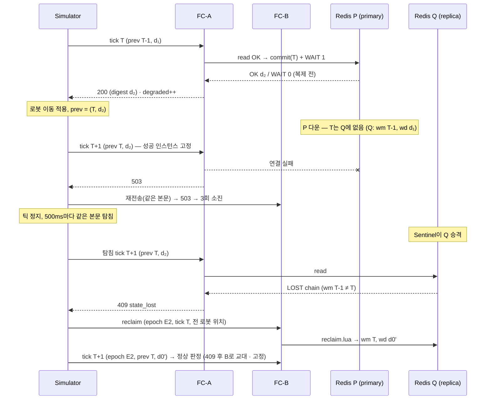
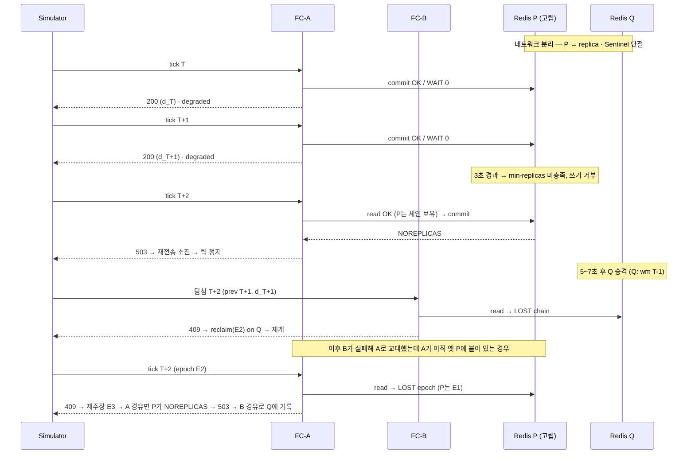

# 08. 고가용성 상세 설계

07의 큰 틀 아래 위임 항목 1~13을 채운다. 설정 값마다 근거를 한 줄로 붙인다.
측정으로 확정해야 하는 값은 "M4 측정" 또는 "M8 측정"으로 표시한다.

---

## 07 대비 변경점

07의 제약을 바꾼 곳이다. 나머지는 07을 그대로 따른다.

| # | 07 원문 | 08 결정 | 근거 |
|---|---|---|---|
| C1 | 장애 조치 = 상태 소실로 취급. 감지하면 항상 `409` | **해시 체인 워터마크 검증.** 새 primary가 Simulator가 적용한 마지막 판정까지 갖고 있으면 그대로 진행, 하나라도 빠졌거나 갈라졌으면 `409` | 복제는 primary 쓰기 순서의 접두사다. 마지막 판정의 다이제스트가 일치하면 그 이전 상태도 전부 일치한다(아래 "불변식"). 손실 여부를 정확히 알 수 있으므로 "항상 409"보다 엄격하고, 불필요한 재주장이 없다 |
| C2 | `WAIT 1`은 감지 창의 2차 안전망 | `WAIT 1`은 **안전성과 무관**. 장애 조치 뒤 재주장 빈도를 줄이는 장치 | 감지 창의 이중 승인은 체인 검증이 막는다. WAIT 실패는 "이 틱이 복제됐는지 모름"일 뿐이고, 다음 틱의 체인 검증이 그 답을 낸다 |
| C3 | 재전송 기록 키 `(mapId, tick)`, TTL 수 틱 | 맵 해시 안에 **최신 1틱 기록만** 둔다. 다음 틱 커밋이 덮어쓴다 | Simulator는 응답을 받기 전에 다음 틱을 보내지 않고, 다음 틱을 보낸 뒤에는 이전 틱을 다시 보내지 않는다. 기록 = 워터마크가 되어 별도 TTL 조정이 필요 없다 |
| C4 | (01) Redis 왕복 배치당 1회(Lua) | 배치당 **2회**: 읽기 Lua 1 + 커밋 Lua 1(`WAIT`는 커밋과 파이프라인) | 판정 기록에 교착 해소 결과까지 넣어야 락과 같은 원자 단위가 된다. 교착 탐지는 락 결과를 본 뒤에야 가능하므로 "읽기 → 메모리 판정 → 원자 커밋"으로 나눈다 |
| C5 | (01) 칸별 락 키, 논리 20틱 + 실시간 TTL 만료 | 맵당 **단일 해시**, 칸별 만료 폐지. 해제는 명시적으로만 | 기존 규칙에 결함 두 개: ① 이동 요청을 보내지 않는 정지 로봇(Idle·Loading)의 칸 락이 20틱 뒤 만료되어 다른 로봇이 그 칸을 승인받는다. ② 틱 정지가 실시간 TTL(배속 1에서 2초)보다 길면 칸 락이 일부만 사라져 구멍이 생긴다. 단일 키는 통째로만 만료되므로 구멍이 생기지 않는다 |
| C6 | 틱마다 로드밸런서가 임의 인스턴스로 | **고정 주소 목록 + Simulator 측 선택.** 성공한 인스턴스에 고정, 실패 · 409 시 다른 인스턴스로. M5~ 주소는 노드 IP + FleetController `hostPort`(아래 "설비 유입 · LB" 1) | ClusterIP는 HTTP keep-alive 연결 하나에 고정되어 교대가 안 되고, 재전송이 같은 죽은 pod로 갈 수 있다. node-1(API 서버) 다운 시 endpoint 갱신이 멈춰 죽은 pod가 Service에 남는다. Simulator가 클러스터 밖이라 headless DNS(pod IP)는 닿지 않는다 |
| C7 | (01) Ingest 멱등 키 실패 처리 없음 | Redis 오류 시 1단계를 **건너뛰고 발행**(fail-open) | 07 정합성 원칙에서 `idem:*`은 유실 허용, 중복은 워커가 막는다. Redis 장애 조치(최대 30초) 동안 이벤트 파이프라인을 세울 이유가 없다 |

---

## 핵심 장치 — 해시 체인 워터마크

위임 항목 3(감지)과 4(재전송 멱등)는 같은 장치로 푼다.

### 맵 상태 단일 해시

판정 안전에 필요한 상태는 전부 `fleet:map:{mapId}` 해시 하나에 둔다.

| 필드 | 값 | 역할 |
|---|---|---|
| `epoch` | Simulator가 발급한 세대 id, **UUIDv7** (소문자 표준 표기) | 재주장마다 바뀌고 단조 증가한다. 문자열 비교 = 발급 시각 비교. 기존 `fleet:epoch:{mapId}` 대체 |
| `wm` | 마지막으로 커밋된 tick | 워터마크 |
| `wd` | 마지막 커밋의 다이제스트 | 체인 꼬리 |
| `wd0` | 재주장 시점의 다이제스트(체인 뿌리) | 재주장 재요청 응답 |
| `rh` | 마지막 커밋 요청 본문의 해시 | 같은 tick 재요청 판별 |
| `rec` | 마지막 커밋의 응답 본문(JSON) | 재요청에 그대로 반환 |
| `rch` | 재주장 요청 본문의 해시 | 재주장 멱등 |
| `c:{x}:{y}` | `{robotId}:{tick}` | 칸 점유. 값의 tick은 진단용 |
| `r:{robotId}` | `{x},{y}` 또는 `{x},{y};{tx},{ty}` | 로봇 현재 칸과 이동 중 목표 칸 |
| `wg` | JSON `{robotId: "blockedBy:tick"}` | 대기 그래프 (04). 50틱 지난 항목은 무시 |
| `dl` | JSON `{cycleKey: "tick:yieldRobotId:x,y"}` | 교착 해소 결정 (04). 50틱 |
| `yl` | JSON `{robotId: tick}` | 양보 중 표시 (04). 50틱 |

| 결정 | 근거 |
|---|---|
| 키 TTL `30s`, 커밋마다 갱신 | 칸 단위 만료를 없앴으므로 TTL은 버려진 맵 정리용이다. 30초 넘게 틱이 멈췄다면 이미 07 예산 초과이므로 통째로 만료시키고 재주장으로 시작하는 편이 깔끔하다 |
| 한 키에 모두 | 두 키에 나누면 만료 시점이 달라 "워터마크는 있는데 락은 없는" 상태가 생긴다. 단일 키는 있거나 없거나 둘 중 하나 |
| `robot:state`, `metrics:*`, `idem:*`는 밖에 둔다 | 판정 안전과 무관한 캐시다. 소실돼도 겹침이 생기지 않는다 |

### 다이제스트 체인

```
d0 = sha1(epoch ‖ 재주장 본문 해시)                     -- 재주장이 뿌리를 만든다
dT = sha1(d(prev) ‖ reqHash T ‖ 응답 본문 T)            -- 커밋마다 한 고리
```

`reqHash`(요청 · 해제 전체)를 고리에 넣는다. 응답만 넣으면 `releases`가 다르고 `decisions`가 같은 두 커밋이 같은 꼬리를 가져, "같은 꼬리 ⇒ 같은 칸 상태"가 Simulator 본문 불변 가정에 기대게 된다.

요청은 `prev = {tick, digest}`(Simulator가 마지막으로 **적용한** 판정)를 싣고, 응답은 새 `digest`를 돌려준다.

### 커밋 조건 (커밋 Lua 안에서 원자 검사)

| # | 조건 | 실패 시 |
|---|---|---|
| 1 | 키가 있고 `epoch` 일치 | `409 state_lost` (`missing` / `epoch`) |
| 2 | `wm == tick`이면 재요청: `rh` 일치 → 기록 반환, 불일치 → 거부 | `409 batch_mismatch` |
| 3 | `wm == prev.tick` 이고 `wd == prev.digest` | `409 state_lost` (`chain`) |
| 4 | 쓰려는 칸 필드가 읽기 단계에서 본 값과 같다 (방어 검사) | `409 state_lost` (`conflict`) |

### 불변식

> **저장소 X가 tick T를 커밋할 수 있다 ⇔ X의 체인 꼬리가 Simulator가 적용한 마지막 판정과 같다.**
> 고리마다 직전 꼬리를 검사하고 들어갔으므로 꼬리가 같으면 뿌리(재주장)부터 전체 이력이 같다.
> 즉 X의 칸 점유 = Simulator의 실제 위치. 그 위에서 내린 판정은 겹침을 만들 수 없다.

| 경우 | 꼬리 | 결과 |
|---|---|---|
| 새 primary가 마지막 틱까지 복제받음 | 일치 | 그대로 진행. 정지는 장애 조치 시간뿐 |
| 마지막 틱(들)이 복제 전에 primary가 죽음 | `wm`이 뒤처짐 | `409 chain` → 재주장 |
| 분리된 옛 primary와 새 primary가 같은 tick을 각각 커밋 (아래 시퀀스 B) | 다이제스트가 다름 | Simulator가 받지 않은 쪽은 영원히 `409` |
| Redis 재시작으로 빈 상태 / `FLUSHDB` | 키 없음 | `409 missing` → 재주장 (01 기존 절차와 동일) |
| 두 저장소에서 우연히 같은 판정이 나옴 | 일치 | 상태가 실제로 같으므로 안전 |

---

## 1. Sentinel · Redis 설정 값

### Sentinel

| 설정 | 값 | 근거 |
|---|---|---|
| `sentinel monitor fleet <master> 6379 2` | quorum 2 | 07. 3개 중 1개 손실까지 합의 |
| `down-after-milliseconds` | **5000** | 오탐 방어 우선. VM CPU steal · AOF rewrite fork · 노드 네트워크 순간 지연은 1~2초 안쪽이다. 5초면 여유 2배 이상이고 30초 예산에서 감당된다(아래 타임라인) |
| `failover-timeout` | **6000** | 선출 분열 시 재시도 간격이 `2 × failover-timeout` = 12초. 이 값이 최악 경로를 30초 안에 묶는다. 승격 자체는 1초 안이라 6초는 중단 위험이 없다 |
| `parallel-syncs` | 1 | 승격 후 남는 replica가 1대뿐이라 값의 효과가 없다. 기본값 유지 |
| `resolve-hostnames` / `announce-hostnames` | yes | pod IP가 재시작마다 바뀐다. headless DNS 이름으로 알린다 |

### Redis

| 설정 | 값 | 근거 |
|---|---|---|
| 버전 | 7.2 | shebang 플래그(`no-writes`), 스크립트 효과 복제(MULTI/EXEC로 감싸 복제 → replica에서도 원자) |
| `min-replicas-to-write` | 1 | 07. 고립된 옛 primary 쓰기 차단 |
| `min-replicas-max-lag` | **3** | `down-after`(5초)보다 짧아야 옛 primary가 새 primary 승격 **전에** 스스로 쓰기를 멈춘다. replica ACK는 1초 주기 |
| `appendonly` / `appendfsync` | yes / everysec | `down-after` 안에 재시작된 primary가 빈 채로 떠서 replica까지 비우는 사고를 줄인다. 정합성은 체인이 맡으므로 1초 유실은 무방 |
| `save` | `""` | RDB fork 불필요 |
| `repl-diskless-sync` / `-delay` | yes / **0** | 기본 지연 5초가 장애 조치 후 전체 재동기화를 그만큼 늦춘다. 30초 예산에서 뺀다 |
| `maxmemory` / 정책 | 192mb / `noeviction` | 맵 해시를 축출하면 안 된다. 메모리 limit 512Mi에서 AOF rewrite fork 여유를 남긴다 |
| `auto-aof-rewrite-min-size` | 64mb | 틱마다 `rec`(약 15KB)를 덮어써 AOF가 빨리 자란다. 데이터 자체는 1MB 미만이라 rewrite가 싸다 |

---

## 2. 판정 경로와 `WAIT 1`

### 배치 1건의 처리

| 단계 | Redis 왕복 | 내용 |
|---|---|---|
| ① 읽기 | 1 | `read.lua` — 커밋 조건 1~3 검사, 재요청이면 기록 반환(여기서 끝). 아니면 요청·해제 로봇의 `c:` · `r:` 필드와 `wg` · `dl` · `yl` 반환 |
| ② 메모리 판정 | 0 | 해제 적용 → 01 "배치 내 판정 순서" 1~3단계 → 대기 그래프 갱신 → 교착 탐지·해소(04). 결과: 응답 본문 + 필드 변경 목록(diff) |
| ③ 커밋 | 1 | `commit.lua` (조건 1~4 재검사 → diff 적용 → `wm`·`wd`·`rh`·`rec` 기록) **와 `WAIT 1 5`를 같은 연결에 파이프라인** |

### p99 10ms 예산

가정: 노드 간 왕복 p99 ≤ 1ms (같은 L2 대역), 200대 기준 Lua 실행 ≤ 0.5ms. 둘 다 M4 측정.

| 구간 | 정상 p99 | WAIT 응답 지연 시 |
|---|---|---|
| ① 읽기 (왕복 1 + 실행) | 1.5ms | 1.5ms |
| ② 메모리 판정 (정렬 · 점유 · 교착) | 1.0ms | 1.0ms |
| ③ 커밋 (왕복 1 + 실행) | 1.5ms | 1.5ms |
| ③ `WAIT` 대기 (replica ACK 왕복) | 1.0ms | **가드에서 끊음** — 서버 `WAIT 1 5`의 5ms는 목표일 뿐 상한이 아니다 |
| 직렬화 · HTTP 처리 | 0.5ms | 0.5ms |
| **합계** | **5.5ms** | **≤ 9.5ms** = 배치 시작 + 9ms 클라이언트 가드 + 직렬화 0.5ms |

> **상한은 서버 타임아웃이 아니라 FleetController의 가드가 보장한다.** 서버 타임아웃이 늦게 와도 응답은 9.5ms 안에 나간다.
> M4 측정에서 왕복이 가정보다 크면 가드와 WAIT 타임아웃을 함께 내린다. 바뀌는 건 degraded 빈도뿐이다(C2).

| 결정 | 근거 |
|---|---|
| `WAIT`는 커밋과 **같은 연결**에서 | `WAIT`는 그 연결의 마지막 쓰기 오프셋을 기다린다. 다른 연결에서 부르면 즉시 0을 기다리고 끝난다 |
| 커밋 전용 연결 2개(풀), 판정 경로 외 사용 금지 | `WAIT` 중인 연결은 서버에서 막혀 뒤 명령이 줄을 선다. 공용 멀티플렉서에 섞으면 다른 명령이 최대 타임아웃만큼 밀린다 |
| 클라이언트 가드: 커밋 응답은 20ms, `WAIT` 응답은 배치 시작부터 9ms까지만 기다린다 | p99 상한의 실제 근거. 가드에 걸린 연결은 `WAIT` 응답이 올 때까지 풀에서 뺀다 |
| Redis `hz`는 기본값(10) 유지 | Redis 7.2 소스 확인: 블로킹 클라이언트 타임아웃은 `beforeSleep()`의 `handleBlockedClientsTimeout()`이 이벤트 루프마다 검사한다(`src/timeout.c`). 루프는 I/O나 시간 이벤트(`serverCron`, 주기 1/`hz`)에만 깨어난다(`src/ae.c` `usUntilEarliestTimer`). 다음 배치의 읽기 Lua가 같은 서버에 I/O를 일으켜 루프를 깨우므로, 가드에 걸린 `WAIT`는 다음 커밋 전에 풀린다. 응답 지연은 가드가 막으므로 `hz`를 올릴 이유가 없다 |

### `WAIT` 결과별 동작

| 결과 | 판정 응답 | 메트릭 |
|---|---|---|
| ≥ 1 | 200 | — |
| 0 (타임아웃) 또는 가드 초과 | **200, 승인 유효** | `fleet_redis_wait_degraded_total{map_id}` |
| 커밋 응답 자체를 못 받음 | 503 | 커밋 여부를 모르므로 재전송에 맡긴다. 재전송은 기록 반환 또는 새 커밋 중 하나로 수렴(§4) |
| 커밋이 `NOREPLICAS` / `READONLY` | 503 | §7 재연결 트리거 |

**연속 실패 시 `state_lost`로 보내지 않는다.** 판정은 권위 있는 primary의 전체 상태 위에서 내려졌으므로 불확실한 것은
"이 틱의 내구성"뿐이고, 그 답은 다음 틱의 체인 검사가 낸다. 같은 primary에 재주장해 봐야 쓰는 곳이 같아 안전이 늘지 않고
틱만 멈춘다. 대신 `min-replicas-max-lag 3`이 고립 primary를 3초 안에 쓰기 거부로 만들고, 알림을 건다.

```yaml
- alert: RedisReplicationDegraded
  expr: rate(fleet_redis_wait_degraded_total[1m]) / rate(fleet_move_batches_total[1m]) > 0.5
  for: 30s
```

---

## 3. 장애 조치 감지

### 감지 수단

| 순위 | 수단 | 위치 | 쓰임 |
|---|---|---|---|
| 1 | 체인 검사 (`read.lua` · `commit.lua`) | 판정 경로, **배치마다** | 유일한 안전 장치. 손실·분기를 `409`로 바꾼다 |
| 2 | 연결 오류 · `READONLY` · `NOREPLICAS` | 판정 경로 | 503 + Sentinel 재질의(§7) |
| 3 | Sentinel `+switch-master` 구독 | 백그라운드 | 재연결을 앞당기고 `fleet_redis_failover_total`을 올린다. **판정에 쓰지 않는다** |

`409` 이후는 01 "Redis 상태 소실 복구" 그대로다. 새 `epoch`는 Simulator가 발급하고, 재주장 tick은 **마지막으로 적용한 tick**이다
(멈춘 틱은 아직 판정 전이므로). 재주장 직후 첫 배치는 `prev = {재주장 tick, d0}`.

### 감지 → 재개 30초 타임라인 (Redis primary pod 강제 종료)

| 단계 | 일반 | 최악 | 근거 |
|---|---|---|---|
| SDOWN | 5.0s | 5.0s | `down-after-milliseconds` |
| ODOWN 합의 | 0.5s | 1.0s | Sentinel 상호 질의 1초 주기 |
| 리더 선출 | 0.5s | 1.0s + **12.0s** + 1.0s | 무작위 지연 ≤ 1초. 표 분열 1회 시 `2 × failover-timeout` 후 재시도 |
| 승격 확인 | 1.0s | 2.0s | 승격 replica `INFO` 1초 주기 |
| 남은 replica 재연결 (`min-replicas-to-write` 충족) | 0.5s | 2.0s | PSYNC2 부분 재동기화. 실패해도 diskless · delay 0 |
| FleetController 재연결 | 0.3s | 2.0s | `+switch-master` 즉시 또는 오류 시 재질의(250ms 간격) |
| Simulator 탐침 대기 | 0.25s | 0.5s | 탐침 주기 500ms (§5) |
| 체인 불일치 → `409` → 재주장 → 재개 | 0.01s | 0.2s | 왕복 3회 |
| **합계** | **약 8s** | **약 27s** | 30초 이내 |

> 표 분열이 두 번 나면 30초를 넘는다. 남은 Sentinel 2개가 동시에 출마해야 일어나는 일이라 무작위 지연으로 드물다.
> M8에서 `+failover-end` 까지의 분포를 기록하고, 넘으면 `failover-timeout`을 5000으로 내린다.

### 시퀀스 A — primary 다운, 마지막 틱 미복제



> Q 위에서 T+1이 판정되는 길은 재주장 뒤 하나뿐이고, 재주장은 Simulator의 실제 위치로 칸을 채운다.
> T의 락이 없는 Q 위에서 내려진 승인은 존재하지 않는다.

### 시퀀스 B — 감지 전 1~2틱 (primary 고립, 애플리케이션은 계속 닿음)



| 창 | 승인이 내려진 상태 | 겹침 가능성 |
|---|---|---|
| T, T+1 (감지 전) | P — Simulator가 적용한 모든 판정을 가진 유일한 저장소 | 없음. 정상 판정과 같다 |
| T+1 이후 ~ Q 승격 | 어디서도 커밋 불가 (P는 `NOREPLICAS`, Q는 replica) | 없음. 틱 정지 |
| Q 승격 후 | Q — T, T+1을 모름 | 체인 불일치로 판정 자체가 불가. 재주장 뒤에만 판정 |
| 분리 해소 전 P | 옛 `epoch` | `epoch` 불일치 + 쓰기 거부 |

**분리 비대칭 사례** — P가 replica 하나를 데리고 고립되면(`{P, R1}` | `{Q, R2, Sentinel 2}`) P는 계속 쓰기를 받는다.
FC-A는 P, FC-B는 Q에 붙은 채로 같은 tick을 각각 커밋할 수 있다. Simulator가 받은 쪽의 다이제스트만 다음 `prev`가 되므로
다른 쪽은 그 tick 이후 영원히 `409`다. 결과는 재주장 핑퐁(진행 정지)이지 겹침이 아니다. 진행은 분리가 풀려 Sentinel이
P를 replica로 내릴 때 회복된다. **안전은 보장, 진행은 미보장** — 07 "멈춤은 허용, 겹침은 불허"에 맞는다.

---

## 4. 재전송 멱등 Lua 규약

### 스크립트

`read.lua` — 쓰기 없음. 재요청이면 여기서 기록을 돌려주고 끝난다.

```lua
#!lua flags=no-writes
-- KEYS[1] = fleet:map:{mapId}
-- ARGV[1] epoch  ARGV[2] tick  ARGV[3] prevTick  ARGV[4] prevDigest  ARGV[5] reqHash
-- ARGV[6..] 판정에 필요한 필드 (요청 · 해제 로봇의 c:x:y, r:robotId)
local k = KEYS[1]
local m = redis.call('HMGET', k, 'epoch', 'wm', 'wd', 'rh', 'rec', 'wg', 'dl', 'yl')
if not m[1] then return {'LOST', 'missing'} end
if m[1] ~= ARGV[1] then return {'LOST', 'epoch'} end
if m[2] == ARGV[2] then
  if m[4] == ARGV[5] then return {'DONE', m[5], m[3]} end
  return {'MISMATCH'}
end
if m[2] ~= ARGV[3] or m[3] ~= ARGV[4] then return {'LOST', 'chain'} end
local vals = {}
if #ARGV >= 6 then vals = redis.call('HMGET', k, unpack(ARGV, 6, #ARGV)) end
return {'OK', m[6] or '', m[7] or '', m[8] or '', vals}
```

`commit.lua` — **락 획득과 판정 기록이 같은 스크립트**. 모든 검사를 첫 쓰기 전에 끝낸다(Lua는 롤백이 없다).

```lua
#!lua
-- KEYS[1] = fleet:map:{mapId}
-- ARGV[1] epoch  ARGV[2] tick  ARGV[3] prevTick  ARGV[4] prevDigest  ARGV[5] reqHash
-- ARGV[6] 응답 본문(JSON)  ARGV[7] ttlMs  ARGV[8] nGuard  ARGV[9] nDel
-- 이어서 guard 2×nGuard (필드, 읽기 단계에서 본 값 — 없으면 "")
--       del   nDel     (필드)
--       set   나머지    (필드, 값) 쌍
local k = KEYS[1]
local m = redis.call('HMGET', k, 'epoch', 'wm', 'wd', 'rh', 'rec')
if not m[1] then return {'LOST', 'missing'} end
if m[1] ~= ARGV[1] then return {'LOST', 'epoch'} end
if m[2] == ARGV[2] then
  if m[4] == ARGV[5] then return {'DONE', m[5], m[3]} end    -- 경쟁한 다른 인스턴스가 먼저 커밋
  return {'MISMATCH'}
end
if m[2] ~= ARGV[3] or m[3] ~= ARGV[4] then return {'LOST', 'chain'} end

local nGuard, nDel = tonumber(ARGV[8]), tonumber(ARGV[9])
local i = 10
for _ = 1, nGuard do
  local v = redis.call('HGET', k, ARGV[i]) or ''
  if v ~= ARGV[i + 1] then return {'CONFLICT', ARGV[i], v} end
  i = i + 2
end
-- 여기부터 쓰기. 이후 실패 분기 없음
if nDel > 0 then redis.call('HDEL', k, unpack(ARGV, i, i + nDel - 1)) end
i = i + nDel
local digest = redis.sha1hex(ARGV[4] .. '\n' .. ARGV[5] .. '\n' .. ARGV[6])   -- prev ‖ reqHash ‖ 응답
redis.call('HSET', k, 'wm', ARGV[2], 'wd', digest, 'rh', ARGV[5], 'rec', ARGV[6],
           unpack(ARGV, i, #ARGV))
redis.call('PEXPIRE', k, ARGV[7])
return {'OK', digest}
```

`reclaim.lua` — 같은 `epoch` 재요청은 무변경, 현재보다 오래된 `epoch`는 거부.

```lua
#!lua
-- KEYS[1] = fleet:map:{mapId}
-- ARGV[1] epoch  ARGV[2] tick(마지막 적용 tick)  ARGV[3] 본문 해시  ARGV[4] ttlMs
-- ARGV[5..] (필드, 값) 쌍 — 로봇마다 c:현재칸, (이동 중이면) c:다음칸, r:robotId
local k = KEYS[1]
local m = redis.call('HMGET', k, 'epoch', 'rch', 'wd0')
if m[1] == ARGV[1] then
  if m[2] == ARGV[3] then return {'DONE', m[3]} end
  return {'MISMATCH'}
end
if m[1] and ARGV[1] < m[1] then return {'STALE', m[1]} end   -- 지연 도착한 옛 재주장은 맵을 되감지 못한다
local root = redis.sha1hex(ARGV[1] .. '\n' .. ARGV[3])
redis.call('DEL', k)
redis.call('HSET', k, 'epoch', ARGV[1], 'wm', ARGV[2], 'wd', root, 'wd0', root,
           'rch', ARGV[3], 'rh', '', 'rec', '', unpack(ARGV, 5, #ARGV))
redis.call('PEXPIRE', k, ARGV[4])
return {'OK', root}
```

| 규약 | 내용 | 근거 |
|---|---|---|
| 요청 해시 | `sha256(canonical(mapId, tick, epoch, prev, requests, releases))` 앞 16바이트 hex | JSON 공백 · 필드 순서와 무관하게 같은 의미면 같은 해시 |
| `lockToken` | `{robotId}:{tick}` — 난수 없음 | 재판정해도 토큰이 같다. 해제 검증은 커밋 Lua의 guard가 대신한다 |
| 해제 | `ReleaseAsync`는 즉시 보내지 않고 **다음 배치의 `releases`** 에 싣는다 | 해제도 같은 원자 커밋 · 같은 체인에 들어간다. 별도 쓰기가 없으니 체인 밖 상태가 없다 |
| `From` 불일치 | `r:` 의 현재 칸 ≠ 요청 `From` → `409 state_lost(from_mismatch)` | 불확실하면 정지 |
| 응답 매핑 | `OK`/`DONE` → 200, `LOST`·`CONFLICT` → 409 `state_lost`, `MISMATCH` → 409 `batch_mismatch`, Redis 오류 → 503 | Simulator는 `batch_mismatch`도 재주장으로 처리한다(본문이 바뀐 재전송은 버그) |
| 재주장 `STALE` | 현재보다 오래된 `epoch`의 재주장은 거부하고 현재 `epoch`를 돌려준다(응답 409 `stale_epoch`). Simulator는 이미 버린 시도면 무시한다. 자기가 발급하지 않은 더 새 `epoch`면(재시작 후 시계가 뒤로 간 경우) `max(현재 시각, 받은 epoch 시각 + 1ms)`로 새 UUIDv7을 만들어 다시 보낸다 | 늦게 도착한 옛 재주장이 맵을 되감아 불필요한 정지 · 재주장 1회를 만드는 경로를 없앤다 |
| 스크립트 적재 | 기동 시 `SCRIPT LOAD`, `NOSCRIPT`면 1회 재적재 후 재시도 | 장애 조치 후 새 primary에는 스크립트 캐시가 없다 |

### 첫 처리 중 인스턴스가 죽는 모든 시점

FC-A가 tick T를 처리하다 죽거나 멈추고, Simulator가 같은 본문을 FC-B로 재전송한다.
"동일"의 정의: **Simulator가 적용하는 판정은 틱당 정확히 하나이고, Redis의 기록과 같다.**

| # | FC-A가 멈춘 시점 | Redis | FC-B 경로 | Simulator가 적용 | 동일 |
|---|---|---|---|---|---|
| 1 | 읽기 전 | 변화 없음 | read OK → 판정 → commit OK | D_B | ✓ 존재하는 판정은 D_B뿐 |
| 2 | 읽기 후 · 커밋 전송 전 | 변화 없음 | 1과 같음 | D_B | ✓ |
| 3 | 커밋 전송 중 (Redis 미수신) | 변화 없음 | 1과 같음 | D_B | ✓ |
| 4 | 커밋 실행 후 · `WAIT` 응답 전 | `wm=T`, `rec=D_A` | read → `DONE` | D_A | ✓ |
| 5 | `WAIT` 후 · HTTP 응답 전 | 4와 같음 | read → `DONE` | D_A | ✓ |
| 6 | HTTP 응답 송신 후 유실 · Simulator 시도 타임아웃 후 도착 | 4와 같음 | read → `DONE` | D_A (늦은 응답은 폐기, 어차피 D_A) | ✓ |
| 7 | 멈췄다 살아남, FC-B가 먼저 커밋 | `rec=D_B` | — | D_B. FC-A의 commit은 `DONE(D_B)`를 받는다 | ✓ |
| 8 | 멈췄다 살아남, FC-A 커밋이 FC-B 읽기와 커밋 사이 | `rec=D_A` | commit → `DONE(D_A)` | D_A | ✓ |
| 9 | 4~6 직후 primary도 다운, T 미복제 | 새 primary `wm=T-1` | 장애 조치 후 read OK → 새 판정 | D_B. D_A는 아무도 적용하지 않음 | ✓ |
| 10 | D_A가 Simulator에 적용된 뒤 primary 다운 | 새 primary `wm=T-1` | 재전송 없음. T+1에서 `chain` → 재주장 | — | ✓ |

> 9번에서 D_A와 D_B가 다를 수 있지만 D_A는 관측되지 않았다. 07의 "같은 입력에 다른 판정 불가"는
> **관측된 판정이 바뀌지 않는다**로 해석한다. 관측된 판정(10번)은 체인 때문에 절대 뒤집히지 않는다.

### 교착 해소 락(04)과의 상호작용

| 04 장치 | M4 이후 | 근거 |
|---|---|---|
| `deadlock:resolve:{mapId}:{cycleKey}` `SET NX` | 맵 해시 `dl` 필드. 커밋 Lua 안에서만 기록 | 판정 기록과 같은 원자 단위가 된다 |
| 04 경합 (a) "재전송으로 다른 pod가 같은 틱 재처리" | **재탐지 자체가 없다.** 재전송은 기록 반환(4~8번) 또는 아무것도 커밋되지 않은 상태에서의 첫 처리(1~3번) | 같은 tick에 해소 결정이 두 번 커밋될 길이 없다 |
| "두 번째 발견자는 값을 읽어 같은 결정" | 유지. ② 메모리 판정이 `dl`에 살아 있는(50틱 이내) 해소가 있으면 새로 정하지 않고 그 결정을 쓴다 | 다음 틱에 같은 순환을 다시 봐도 양보 로봇이 바뀌지 않는다 |
| `robot:yielding:{robotId}` TTL 50틱 | `yl` 필드, tick 비교로 50틱 | 실시간 TTL 제거 (C5) |
| 해소 완료 시 락 삭제 | 커밋 diff로 `dl` · `yl` 항목 제거 | |
| 04 경합 (b) M8 이후 백그라운드 탐지기 | **도입하려면 같은 커밋 조건(체인)을 거쳐야 한다.** 별도 쓰기 경로 금지 | 체인 밖 쓰기가 생기면 불변식이 깨진다 |

---

## 5. Simulator 재전송 정책

| 항목 | 값 | 근거 |
|---|---|---|
| 시도 타임아웃 | **100ms** | 판정 p99 10ms의 10배. 배속 1에서 1틱 |
| 시도 횟수 | **3** (최초 1 + 재시도 2) | 두 인스턴스에 각 1회 이상 + 1회 여유. 소진까지 최대 약 320ms |
| 백오프 | 0ms → 20ms | 첫 재시도는 다른 인스턴스로 즉시 |
| 대상 선택 | **성공한 인스턴스에 고정**. 실패(타임아웃 · 연결 · 503) 또는 409일 때만 다른 인스턴스로 바꾼다 | C6. 틱마다 교대하면 분리 비대칭(§3)에서 두 저장소를 번갈아 밟아 재주장 핑퐁이 매 틱 난다. 고정하면 한쪽에서 안정된다. 주소는 설정의 고정 목록(갱신 없음, "설비 유입 · LB" 1) |
| 연결 거부 | 즉시 다음 주소로. **시도 횟수에 세지 않는다**. 한 시도 안에서 주소가 모두 거부면 그 시도를 실패로 센다 | 노드 3대에 FleetController 2대라 빈 주소가 하나 있다. 요청이 전달되지 않았으므로 멱등 · 체인과 무관하고, 빈 주소가 시도 3회를 갉아먹지 않는다 |
| 재시도 대상 오류 | 타임아웃, 연결 실패, 503 | 409는 재시도하지 않는다 → 재주장 |
| 소진 시 | **틱 정지.** 500ms마다 같은 본문으로 탐침 | 30초 예산에서 탐침 지연 ≤ 0.5초 |
| 409 | 재주장(`epoch` 새로 발급) → 성공 시 같은 tick을 새 `epoch` · `prev`로 판정 | 01 복구 절차 |
| 재주장 재시도 | 같은 `epoch` 본문으로 500ms마다 | 재주장 Lua가 멱등 |
| 불변 | `tick`, `epoch`, `prev`, `requests`, `releases`, 이벤트 배치 `batchId` | 직렬화한 본문 바이트를 그대로 재사용 |
| 늦은 응답 | 취소된 시도의 응답은 버린다 | 틱당 적용되는 응답은 정확히 1개 |
| 빈 배치 | 이동 요청이 없어도 **매 틱 전송** | 해제 전달과 체인 연속. 초당 10건이라 비용 없음 |
| 정지 시간 집계 | `fleet_tick_stall_seconds` (첫 실패 ~ 재개), `fleet_recovery_ticks_total`(01) | M8 측정 지표 |

FleetController 쪽 짝 설정:

| 설정 | 값 | 근거 |
|---|---|---|
| readiness | 프로세스 준비만. **Redis 연결을 보지 않는다** | Redis 장애 중에도 Simulator가 FleetController에 닿아 503/409를 받아야 탐침이 돈다. 02의 일반 규칙(의존성 = readiness)의 예외 |
| `preStop` | 없음 | DNS 갱신 대기가 이유였는데 고정 주소 목록이라 대기할 것이 없다. 진행 중 배치는 Kestrel 정상 종료가 마치고, 다음 요청은 연결 실패 → 교대 |
| `terminationGracePeriodSeconds` | 10 | 진행 중 배치를 마친다 |

---

## 6. 판정 · 경로 계산 엔드포인트 분리

| 엔드포인트 | 구현 | 상태 | 실패 시 |
|---|---|---|---|
| `POST /api/v1/move-requests/batch` | `IMoveArbiter` (`RedisMoveArbiter`) | Redis 맵 해시 | §5 재전송 → 틱 정지 |
| `POST /api/v1/recovery/reclaim` | 같은 Arbiter | Redis 맵 해시 | 500ms 재시도 |
| `POST /api/v1/paths/batch` | `IPathPlanner` (`AStarPathPlanner`) | **없음** | 그 로봇만 이번 틱 계획 실패 → 다음 틱 재시도. 틱은 멈추지 않는다 |

| 결정 | 근거 |
|---|---|
| 경로 입력 = `{mapId, mapVersion, start, startHeading, goal, congestion?}` | 07 제약. Redis를 읽지 않는다 |
| `congestion`은 M4에서 생략(α=0), M7에서 `{alpha, snapshotId}` | 혼잡 가중을 2400칸 배열로 매번 보내지 않고 불변 스냅샷 id로 참조한다. 같은 id = 같은 가중 |
| 경로 요청은 판정 고정 인스턴스가 **아닌** 쪽으로 | 계산 부하 분담이 2대의 존재 이유(07). 판정을 고정해도 부하는 나뉜다 |
| 인스턴스 로컬 LRU 캐시, 키 = 입력 전체, 4096개 | A*가 결정적(06 tie-break)이라 두 인스턴스의 캐시가 달라도 결과가 같다. 캐시는 속도에만 영향 |
| `IPathPlanner`(동기)는 FleetController 안에서 그대로. Simulator 쪽은 비동기 배치 클라이언트 | 06 확장 지점 "M3 FleetController.Api 안으로 이동"의 구체화. A*·`PathResult`는 바뀌지 않는다 |
| `IMoveArbiter` 시그니처 유지 | HTTP 구현이 `epoch` · `prev` · 해제 버퍼를 내부에 들고, 409 처리용 로봇 위치는 생성자로 받은 공급자에서 읽는다 |

메모리 판정(②)은 `InMemoryMoveArbiter`의 판정 본체를 순수 함수 `ArbitrationCore`(스냅샷 + 요청 + 해제 → 결정 + diff)로
떼어 두 구현이 공유한다. M2 테스트가 Redis 구현의 회귀 기준이 된다.

---

## 7. Redis 클라이언트 연결

| 설정 | 값 | 근거 |
|---|---|---|
| 접속 | Sentinel 3개 주소 + 서비스 이름 `fleet` 으로 primary 탐색 | 07 |
| 멀티플렉서 | 공용 1 (읽기 · `idem` · 캐시) + 커밋 전용 2 (§2) | `WAIT` 격리 |
| `ConnectTimeout` | 1000ms | 재연결 예산 2초 안 |
| 명령 타임아웃 | 판정 경로 20ms, 그 외 1000ms | 판정 경로는 빨리 503을 내고 Simulator 재전송에 맡긴다 |
| 재연결 정책 | 선형 250ms | 장애 조치 직후 빠르게 붙는다 |
| `+switch-master` 구독 | 수신 즉시 재구성 | 오류를 기다리지 않는다(보조) |
| 오류 시 재질의 | 연결 실패 · `READONLY` → Sentinel에 primary 재질의, 1초에 최대 1회 | 강등된 옛 primary에 붙어 있는 경우를 판정 경로에서 끊는다 |
| `NOREPLICAS` | 503만. 재질의하지 않음 | primary는 맞고 replica가 없을 뿐이다 |
| 판정 경로 재시도 | 없음 | 재시도는 Simulator가 한다. 이중 재시도는 지연만 늘린다 |

재연결 시간은 §3 타임라인의 "FleetController 재연결"(일반 0.3초, 최악 2초)에 들어 있다.

---

## 8. RabbitMQ 큐 설정

### 큐 인자

| 인자 | `fleet.task.p00~p15` · `fleet.conflict.p00~p15` (32) | `fleet.telemetry.p00~p15` (16) | 근거 |
|---|---|---|---|
| `x-queue-type` | quorum | classic | 07 |
| 초기 멤버 | M3: 1 → M5: 3 (`rabbitmq-queues grow`) | — (비복제) | 07. 타입은 선언 후 못 바꾼다 |
| `x-single-active-consumer` | true | true | 01. quorum · classic 모두 지원 |
| 리더 배치 | 정책 `queue-leader-locator: balanced` | 정책 `queue-leader-locator: balanced` + `queue-master-locator: min-masters` | 리더를 큐 수가 적은 노드에. RabbitMQ 문서는 큐 인자(`x-`)보다 정책을 권한다. 문서상 새 키는 quorum · stream에 적용되고 classic은 옛 키를 계속 지원한다고만 되어 있어 classic에는 둘 다 건다. 3.13에서 선언 후 `rabbitmqctl list_queues name leader`로 분산 확인(M5) |
| `x-delivery-limit` | **20** | — | 독 메시지가 파티션을 영원히 막지 않게. 워커 재시작 · 리더 교체로 인한 재전달을 견딜 만큼 넉넉히(4.0 기본값과 같음) |
| `x-dead-letter-exchange` | `fleet.dlx` | — | DLQ 1개(`fleet.dlq`, quorum). 순서 불필요 |
| `x-dead-letter-strategy` | at-least-once | — | 데드레터링 중 유실 0. `reject-publish`가 전제 |
| `x-overflow` | reject-publish | drop-head | quorum: 넘치면 발행 nack → Ingest 503 → 역압(유실 0). telemetry: 오래된 것부터 버림 |
| 상한 | `x-max-length-bytes` 64MiB | `x-max-length` 20000 | 아래 |
| 메시지 persistent | yes (quorum은 항상 디스크) | no | 01 |

| 상한 근거 | 계산 |
|---|---|
| quorum 64MiB/큐 | 200대 기준 task+conflict 초당 약 70건 × 0.5KB. PostgreSQL 30분 정지 시 전체 약 63MB → 파티션당 4MB. 16배 여유. 최악 디스크 32 × 64MiB = 2GiB (PV 10Gi) |
| telemetry 20000/파티션 | 초당 2000건 ÷ 16 = 파티션당 125건/초 → 160초 버퍼. 노드당 큐 5~6개 × 20000 × 0.3KB ≈ 36MB |

### 브로커 설정 (`rabbitmq.conf`)

| 설정 | 값 | 근거 |
|---|---|---|
| `cluster_partition_handling` | pause_minority | RabbitMQ 3노드(node-1~3)에서 소수 쪽이 멈춰 classic 큐 split-brain을 막는다. quorum은 Raft가 막는다 |
| `vm_memory_high_watermark.relative` | 0.6 | limit 1Gi 기준 약 614Mi에서 발행 차단 → Ingest 503 → 역압 |
| `total_memory_available_override_value` | 1GiB | 컨테이너 limit을 명시. 노드 전체 메모리로 계산하지 않게 |
| `raft.wal_max_size_bytes` | 64000000 | 기본 512MB WAL 메모리 테이블이 1Gi limit을 넘길 수 있다. 소형 배포 권장 값 |
| `disk_free_limit.absolute` | 2GB | |
| AMQP heartbeat (클라이언트) | 10s | 노드 다운 감지. 기본 60초는 너무 길다 |

### 01 설계와의 정합

| 01 장치 | 영향 | 근거 |
|---|---|---|
| consistent-hash exchange → 16 파티션 | 없음 | exchange는 큐 타입과 무관하게 바인딩한다 |
| SAC + 명부 기반 배정(`partition % N == rank`) | 없음 | 두 타입 모두 SAC 지원. 리더 교체 시 미확인 메시지는 반환되고, quorum은 반환분을 새 메시지보다 먼저 전달해 파티션 순서가 유지된다 |
| 프리페치 50, 순서대로 ack | 없음 | |
| 워커 2차 방어 | 그대로 필요 | 리더 교체 · 워커 재연결 재전달이 같은 `eventId`를 다시 보낸다 |
| `PathReplanned` (유실 허용)이 `fleet.conflict`에 실림 | conflict와 같이 503 대상 | 큐를 따로 만들 가치가 없다. 유실 허용 이벤트가 더 강하게 보호될 뿐 |
| M3 단일 노드에서 선언한 telemetry | M5에서 지우고 재선언 | classic은 선언 노드에 리더가 고정된다. 재선언 중 유실은 telemetry라 허용 |

리더 분산 절차(M5): `rabbitmq-queues grow rabbit@<new-node> all` → `rabbitmq-queues rebalance quorum` → 노드당 리더 약 11개 확인.

---

## 9. 01 멱등 2단계 수정

### 발행 규칙

| 범주 | 확인 대기 | 실패 · 타임아웃 시 |
|---|---|---|
| task · conflict | publisher confirm, **2초** | 배치 실패 → 503 |
| telemetry | publisher confirm, **200ms** | **버리고** `fleet_telemetry_dropped_total{reason}` (nack / timeout / unroutable). 배치 성공 판정에 넣지 않는다 |

### `idem:{batchId}` 상태 전이

| 현재 | 조건 | 다음 | 응답 |
|---|---|---|---|
| (없음) | `SET NX` 성공 | `pending:{now}` → 발행 | — |
| `pending` | task · conflict **전부** 확인 (telemetry 결과 무관) | `done` | 202 |
| `pending` | task · conflict 하나라도 실패 | (내 pending일 때만 삭제) | 503 |
| `pending` (5초 이상) | 고아 재점유 | `pending:{now}` → 발행 | — |
| `done` | 재전송 | 그대로 | 202 (중복) |
| Redis 오류 | 1단계 건너뜀 (C7) | 발행. 성공 후 `done` 기록 시도, 실패 무시 | 202 / 503 |

telemetry만 있는 배치는 항상 `done`이다.

### 책임 분담 (변경 후)

| 주체 | 책임 | 장치 |
|---|---|---|
| Simulator 이벤트 송신기 | 순서 · 재전송 | **배치를 하나씩 순서대로** 보낸다. 202를 받아야 다음 배치. 같은 `batchId`로 재전송. 버퍼 600배치(60초), 가득 차면 틱 정지 |
| IngestApi | task · conflict **유실 0** | confirm 대기. 실패 시 503으로 재전송 유도 |
| EventWorker | **중복 0** (telemetry 포함) | 01 테이블별 2차 방어 그대로 |
| — | telemetry 유실 | 허용. 메트릭으로만 센다 |

> 순서대로 하나씩 보내는 이유 — T가 503이고 T+1이 먼저 202가 되면 같은 로봇의 이벤트가 파티션에 뒤바뀌어 들어간다.
> 재전송된 telemetry의 중복은 자연 키가, task · conflict의 중복은 `eventId`가 막는다.

---

## 10. 노드 · StatefulSet · anti-affinity · local PV

### 노드

| 노드 | k3s | 레이블 | 고정 IP | vCPU | RAM | 디스크 |
|---|---|---|---|---|---|---|
| node-1 | **server** | `fleet/pg=true` | `192.168.10.11` | 2 / 4 | **4GiB / 8GiB** | 40GB |
| node-2 | agent | — | `192.168.10.12` | 2 / 4 | **4GiB / 8GiB** | 30GB |
| node-3 | agent | — | `192.168.10.13` | 2 / 4 | **4GiB / 8GiB** | 30GB |
| **합** | | | | **6 / 12** | **12GB / 24GB** | **100GB** |

설치 명령과 옵션은 02 "k3s 설치". 노드 3대 모두 **taint 없음**, `--kubelet-arg=system-reserved=memory=600Mi`.

| 결정 | 근거 |
|---|---|
| **node-1이 k3s server를 겸임**(전용 control plane 없음) | 2GB를 쓰면서 taint로 워크로드를 전부 배제하는 전용 노드는 순수 낭비다. 과반은 어차피 데이터 멤버가 있는 3대로 닫힌다. 대가는 **node-1 장애 시 API 서버 동반 정지**(아래 "노드 1개 다운 시 과반", §11) |
| 노드 3대를 동일 사양으로 | 노드 타입이 1종이라 설치 스크립트 · PV · 레이블이 단순해진다 |
| 노드 2대로는 불가 | Sentinel은 과반 합의로 승격을 정한다. 투표자가 2면 1개 손실 시 과반(2)을 못 채워 승격이 멈춘다. **서로 다른 장애 도메인의 투표자 3**이 하한이다 |
| PostgreSQL은 레이블로 고정 | 호스트명 대신 `fleet/pg=true` — 노드 교체 시 레이블만 옮긴다. PV의 nodeAffinity는 노드명(`node-1`) |

### 배치

| 노드 | 데이터 계층 | 애플리케이션 |
|---|---|---|
| node-1 | Redis · Sentinel · RabbitMQ | PostgreSQL · nginx ingress · IngestApi · EventWorker(증설분) |
| node-2 | Redis · Sentinel · RabbitMQ | FleetController · IngestApi · EventWorker · QueryApi |
| node-3 | Redis · Sentinel · RabbitMQ | FleetController · IngestApi · EventWorker · Prometheus · Grafana |
| 클러스터 밖 | — | **Simulator**(집 PC 호스트) · `lb-1` · `lb-2`(HAProxy + keepalived, 별도 VM) |

| 워크로드 | 종류 · 수 | anti-affinity | PDB | 비고 |
|---|---|---|---|---|
| Redis | StatefulSet 3 | **required**, `topologyKey: kubernetes.io/hostname` | maxUnavailable 1 | init 컨테이너가 Sentinel에 primary를 묻고 역할 결정(아래) |
| Sentinel | StatefulSet 3 | **required** | maxUnavailable 1 | Redis와 별도 StatefulSet — "Sentinel 1 kill"을 독립 시험 |
| RabbitMQ | StatefulSet 3, `podManagementPolicy: Parallel` | **required** | maxUnavailable 1 | peer discovery k8s 플러그인 |
| FleetController | Deployment 2 | 노드당 최대 1 — **`hostPort: 18080`** 충돌로 스케줄러가 보장 | minAvailable 1 | **required** nodeAffinity `NotIn node-1`. Service 없음. 롤링 `maxSurge 0 · maxUnavailable 1` ("설비 유입 · LB" 1) |
| IngestApi | Deployment 3 | **required** | maxUnavailable 1 | Service `NodePort 30080` · `externalTrafficPolicy: Local`. 롤링 `maxSurge 0 · maxUnavailable 1` · `minReadySeconds 15`, 종료 시 readiness를 끄고 4초 지연(M5 코드) ("설비 유입 · LB" 2) |
| PostgreSQL | StatefulSet 1 | — | — | `nodeSelector: fleet/pg=true` (node-1). 07 범위 밖 |
| CoreDNS | 2 | preferred | — | k3s 기본 1. 노드 하나가 죽어도 DNS가 남게 |

| 결정 | 근거 |
|---|---|
| 데이터 계층은 required — 노드당 1개 | 같은 노드에 둘이 뜨면 그 노드 장애에 과반이 깨진다. 차라리 Pending이 낫다 |
| FleetController는 hostPort로 노드당 최대 1 | 노드 IP:18080이 pod 하나와 1:1이어야 Simulator의 "성공 인스턴스 고정"이 성립한다 |
| FleetController는 node-1을 **required**로 피한다 | node-1 장애 시 재배치가 멈추므로 node-2 · 3에 고정한다. preferred로는 고정되지 않는다 — 스케줄러는 종료 중인 pod도 삭제될 때까지 hostPort를 쥔 것으로 보므로, 롤링 · 재시작의 새 pod가 그 순간 유일하게 비어 있는 node-1로 간다("설비 유입 · LB" 1 "롤링"). 대가: node-2 · 3 장애 중에는 1대로 운영한다(옮겨 갈 곳이 없다) |
| IngestApi는 required — 노드당 1 | 모든 노드가 HAProxy 분배 후보가 된다(02 "설비 데이터 유입"). 노드가 빠지면 그 노드 몫은 **Pending**이고 HAProxy가 분배에서 뺀다 |
| 노드가 빠지면 그 노드의 데이터 pod는 **Pending** | local PV가 노드에 묶여 있고 다른 노드엔 이미 같은 종류가 있다. 의도된 동작. 남은 2개로 과반 유지 |
| Simulator는 클러스터 밖 (07 결정 로그) | 노드 장애가 틱을 직접 끊지 않는다. 노드 장애가 Simulator에 미치는 영향은 FleetController 교대 · Redis 장애 조치 · 이벤트 재전송뿐이고 재배치 · 새 `epoch`가 없다. 집 PC 호스트 장애는 VM까지 함께 멈추므로 범위 밖 |
| RabbitMQ 멤버 3 유지 | 노드 3대가 이미 확보된 이상 추가 부담은 1Gi뿐이다. 잃는 것(M8 leader kill 시나리오, "task · conflict 유실 0을 Raft로 증명")이 더 크다 |

Redis 역할 결정(init):

| 상황 | 동작 |
|---|---|
| Sentinel이 자신이 아닌 primary 주소를 답함 | `replicaof <주소>`로 기동 |
| Sentinel이 아무도 답하지 않음 (최초 기동) | `redis-0`만 primary, 나머지는 `replicaof redis-0` |
| Sentinel이 자신을 primary라고 답함 (`down-after` 안에 재시작) | AOF로 primary 기동. 1초 이내 유실은 체인이 `409`로 잡는다 |

### 노드 1개 다운 시 과반

| 다운 노드 | Redis | Sentinel (quorum 2) | RabbitMQ quorum | FleetController | IngestApi (HAProxy 분배) | 그 밖 |
|---|---|---|---|---|---|---|
| node-1 | 2/3 · primary였으면 장애 조치 | 2/3 · 합의 · 선출 가능 | 2/3 · 리더 재선출 | 2/2 | 2/3 — node-1 DOWN, 재배치 없음(API 서버 정지) | **API 서버 동반 정지** — 다른 노드의 pod는 유지, 스케줄링 · 재배치 · endpoint 갱신 정지, `kubectl` 불가. PostgreSQL 정지(이벤트는 quorum queue에 적체 후 복구 시 소비). **Simulator는 클러스터 밖이라 틱 유지** — Redis primary가 node-1에 있었으면 장애 조치 동안만 정지 |
| node-2 | 2/3 | 2/3 | 2/3 | 1/2 — 1개 Pending, node-2 복귀 시 자동 복귀 | 2/3 — 1개 Pending(required) | Simulator는 node-3 주소로 교대(§5) |
| node-3 | 2/3 | 2/3 | 2/3 | 1/2 — 1개 Pending, node-3 복귀 시 자동 복귀 | 2/3 — 1개 Pending | Simulator는 node-2 주소로 교대(§5). 모니터링 정지(Prometheus Pending → 측정 중이면 지표에 공백) |

그 사이 추가 1대 장애는 **버티지 못한다**(과반 붕괴, 07 설계상 한계).

### 노드별 local PV

`storageClassName: local-storage`, `volumeBindingMode: WaitForFirstConsumer`, `persistentVolumeReclaimPolicy: Retain`.
PV의 `nodeAffinity`는 노드명(`values: [node-1]` 등)을 가리키므로 **k3s 설치 시 `--node-name` 고정이 전제**다(02 "k3s 설치").
빠뜨리면 VM을 다시 만들었을 때 게스트 호스트명이 노드명이 되어 PV가 영원히 Pending된다.

| 노드 | 경로 | PV 이름 | 크기 |
|---|---|---|---|
| node-1 | `/data/redis` | `redis-node-1` | 2Gi |
| node-1 | `/data/sentinel` | `sentinel-node-1` | 64Mi |
| node-1 | `/data/rabbitmq` | `rabbitmq-node-1` | 10Gi |
| node-1 | `/data/postgres` | `pg-data` | 20Gi |
| node-2 | `/data/redis` · `/data/sentinel` · `/data/rabbitmq` | `redis-node-2` · `sentinel-node-2` · `rabbitmq-node-2` | 2Gi · 64Mi · 10Gi |
| node-3 | `/data/redis` · `/data/sentinel` · `/data/rabbitmq` | `redis-node-3` · `sentinel-node-3` · `rabbitmq-node-3` | 2Gi · 64Mi · 10Gi |
| node-3 | Prometheus (실험 구성) | local-path PVC | 보존 2일 |

| 결정 | 근거 |
|---|---|
| Sentinel도 PV | Sentinel은 현재 primary · config epoch를 설정 파일에 다시 쓴다. 잃으면 재시작한 Sentinel이 옛 primary를 감시한다 |
| `WaitForFirstConsumer` | `redis-0`이 어느 노드에 뜨든 그 노드의 PV에 바인딩된다. pod ↔ 노드 고정 불필요 |
| Redis 2Gi | AOF + rewrite 임시 파일. 데이터는 1MB 미만 |
| 백업 | 로컬 VM이라 PV가 인스턴스와 함께 사라지지 않는다. **VM 스냅샷 + 정기 `pg_dump`** |

---

## 11. 리소스 표 근거

표 자체는 02 "고가용성 구성 (M5 + M6)". **기본**(노드 4GiB, 모니터링 없음)과 **실험**(노드 8GiB, Prometheus · Grafana 포함) 두 구성이다.
request 합 **5.16Gi(기본, EventWorker 3) / 5.91Gi(실험)**, limit = request × 2.
Simulator는 클러스터 밖이라 표에서 빠지고(−512Mi · −500m), IngestApi가 노드당 1로 3개가 된다(+256Mi · +200m).

| 결정 | 근거 |
|---|---|
| EventWorker를 HPA 최대(**4**)로 합산하면 | 기본 5.41Gi / 실험 6.16Gi, CPU 4.65 core. 아래 노드별 표는 상한 3(02 HPA) 기준이다 |
| Sentinel 32Mi | 상태가 거의 없는 프로세스. 실측 10Mi 안팎 |
| RabbitMQ 512Mi (limit 1Gi) | quorum 32 + WAL 64MB 제한. 워터마크 0.6이 limit 안에서 역압을 건다 |
| Redis 256Mi (limit 512Mi) | `maxmemory` 192mb + AOF rewrite fork 여유 |
| 노드 시스템 예약 0.6Gi | OS + k3s(server · agent) + kube-proxy · flannel · node_exporter 실사용. k3s 설치 시 `--kubelet-arg=system-reserved=memory=600Mi`로 명시해 allocatable을 **기본 3.4Gi / 실험 7.4Gi**로 고정 |
| MinIO 제외 | 선택 항목. 쓰면 그만큼 여유에서 뺀다 |
| Prometheus는 node-3 local-path PVC, 보존 **2일** | 실험 구성에만 뜬다. node-3 장애 시 Pending(모니터링 정지 — §10 과반 표와 같음) |
| IngestApi 3 | required anti-affinity 노드당 1(§10). 노드가 빠지면 그 몫은 Pending이라 재배치 request에 들어가지 않는다 |
| FleetController는 node-2 · 3 | required nodeAffinity `NotIn node-1`(§10). 그 노드가 빠지면 옮겨 갈 곳이 없어 Pending이다 |
| 호스트 CPU는 줄지 않는다 | Simulator가 VM 밖 호스트 프로세스가 되었을 뿐 같은 6코어를 쓴다. LB VM 2대(1 vCPU씩)도 같은 호스트다(07 오버커밋 수용 결정) |

### 정상 시 노드별 request

| 노드 | 배치 (애플리케이션) | 기본 | ≤ 3.4Gi · 여유 | 실험 | ≤ 7.4Gi · 여유 | CPU (기본 / 실험) |
|---|---|---|---|---|---|---|
| node-1 | PostgreSQL · nginx · IngestApi · EventWorker(증설분) | 1.91Gi | ✓ 1.49Gi | 1.91Gi | ✓ 5.49Gi | 1.55 / 1.55 core |
| node-2 | FleetController · IngestApi · EventWorker · QueryApi | 1.72Gi | ✓ 1.68Gi | 1.72Gi | ✓ 5.68Gi | 1.25 / 1.25 core |
| node-3 | FleetController · IngestApi · EventWorker (+ 실험: Prometheus · Grafana) | 1.53Gi | ✓ 1.87Gi | 2.28Gi | ✓ 5.12Gi | 1.15 / 1.55 core |
| **합계** | | **5.16Gi** | | **5.91Gi** | | **3.95 / 4.35 core** |

노드마다 데이터 멤버(Redis · Sentinel · RabbitMQ 0.78Gi · 0.45 core)가 포함돼 있다.

### 노드 1대 장애 시 재배치 (EventWorker 3)

남은 2대 allocatable = 기본 2 × 3.4Gi = **6.8Gi**, 실험 2 × 7.4Gi = **14.8Gi**.
죽은 노드의 데이터 멤버 3개(0.78Gi), IngestApi(0.25Gi), FleetController(0.25Gi, node-2 · 3 장애일 때)는 local PV · required 규칙으로 **의도적으로 Pending**이다.
노드당 최악은 재배치 pod가 한 노드에 모두 몰린 경우다.

| 장애 | 재배치할 pod | 재배치 request (기본 / 실험) | 남은 2대 합 (기본 / 실험) | 노드당 최악 (기본 / 실험) | Pending | 비고 |
|---|---|---|---|---|---|---|
| node-1 | nginx · EventWorker | 0.38Gi / 0.38Gi | 3.63Gi / 4.38Gi | 2.09Gi / 2.66Gi | 데이터 멤버 3, **PostgreSQL**, IngestApi | **API 서버 동반 정지** — 이 재배치는 node-1 복귀까지 일어나지 않는다(아래). Simulator는 클러스터 밖이라 영향 없음 |
| node-2 | EventWorker · QueryApi | 0.44Gi / 0.44Gi | 3.88Gi / 4.63Gi | 2.34Gi / 2.72Gi | 데이터 멤버 3, IngestApi, FleetController | FleetController 1/2 — node-2 복귀까지 |
| node-3 | EventWorker (+ 실험: Grafana) | 0.25Gi / 0.50Gi | 3.88Gi / 4.13Gi | 2.16Gi / 2.41Gi | 데이터 멤버 3, IngestApi, FleetController (+ 실험: **Prometheus**) | FleetController 1/2 — node-3 복귀까지 |

모두 남은 2대 allocatable(6.8Gi / 14.8Gi) 안이고, 노드당 최악도 기본 3.4Gi 안이다.

node-1은 k3s server를 겸하므로 **API 서버가 함께 내려간다.**

| 항목 | 영향 |
|---|---|
| 이미 떠 있는 pod | node-2 · 3의 kubelet이 계속 실행. Redis · RabbitMQ · FleetController · IngestApi 동작 유지 → **틱 유지**(Simulator는 클러스터 밖) |
| 스케줄링 · 재배치 | **정지**. 위 표의 재배치가 node-1 복귀까지 일어나지 않는다 |
| `kubectl` | 불가 |
| 과반 | Redis · Sentinel · RabbitMQ 모두 2/3로 유지 |
| 설비 유입 | HAProxy가 node-1을 DOWN으로 빼고 node-2 · 3 IngestApi로 분배 |

전용 control plane을 없앤 대가로 생긴 유일한 트레이드오프다. M8 시나리오로 측정해 문서화한다(§12).

CPU는 **실험 구성 기준** 노드당 4 vCPU(기본 구성은 2 vCPU). request 합 4.35 core, 1대 장애 후 Pending을 뺀 3.20~3.50 core가 남은 8 vCPU 안이다.
기본 구성은 3.95 core, 1대 장애 후 2.80~3.10 core가 남은 4 vCPU 안이다. node-2 장애 시 EventWorker · QueryApi가 둘 다 node-1로 가도
1.55 + 0.3 + 0.1 = 1.95 core ≤ 2라 어느 쪽이든 들어간다(FleetController는 Pending, M5 확인).

---

## 12. M8 측정 방법

시나리오 표(명령 · 확인 사항 · 측정 지표 · 합격 기준)는 02 "장애 주입 (M8)". 여기서는 지표를 어떻게 재는지만 정한다.

| 지표 | 정의 | 출처 |
|---|---|---|
| **겹침 수** | 매 틱 적용 후 같은 칸에 로봇 2대 이상인 경우의 수 + 승인 칸이 다른 로봇의 현재 칸인 경우의 수 | Simulator 불변식 검사기 `fleet_overlap_total`. **어떤 시나리오에서도 0** |
| **틱 정지 시간** | 첫 판정 실패 시각 ~ 다음 틱 판정 성공 시각 | `fleet_tick_stall_seconds` 히스토그램 + 구간별 로그 |
| **task · conflict 유실 수** | Simulator 발행 수(범주별 카운터, `eventId` 로그) − PostgreSQL 적재 수(`task_history` 상태 전이 수, `conflict_log` 행 수) | 시나리오 종료 후 적체 0 확인 뒤 대조 SQL |
| **중복 수** | `conflict_log` · `metrics_applied` 기준 같은 `eventId` 2회 적용 | 유니크 제약 위반 로그 수 (0이어야 하고, 위반 시도 수는 별도 기록) |
| **telemetry 유실 수** | Simulator 발행 telemetry 수 − `robot_telemetry` 행 수 | 대조 SQL + `fleet_telemetry_dropped_total` |
| 장애 조치 시간 | Sentinel `+sdown` ~ `+switch-master` | Sentinel 로그 |
| 재전송 결과 | 재전송된 tick마다 Simulator가 적용한 응답 다이제스트 = Redis `wd` | Simulator · FleetController 로그의 `(tick, digest)` 대조 |
| **유입 중단 시간** | 이벤트 배치 첫 송신 실패 시각 ~ 다음 202 시각 | `fleet_event_send_stall_seconds` 히스토그램(Simulator) + 송신 로그 |
| 송신 재시도 · 버퍼 | 재시도 수, 버퍼 최대 깊이(600 중) | `fleet_event_send_retry_total{reason}` · `fleet_event_buffer_depth` |
| VIP 이동 시간 | 장애 주입 시각 ~ `lb-2` keepalived `Entering MASTER STATE` | 장애 주입 스크립트의 시각 + `lb-2` journald |
| HAProxy 분배 제외 시간 | 장애 주입 시각 ~ 그 server `DOWN` | HAProxy 로그(`Server ingest_api/node-N is DOWN`) · `haproxy_server_status` |
| HAProxy 재분배 · 오류 | 연결 실패 재시도 수, 클라이언트에 낸 5xx 수 | `haproxy_backend_retry_warnings_total` · `haproxy_backend_redispatch_warnings_total` · `haproxy_backend_http_responses_total{code="5xx"}` |

Simulator는 클러스터 밖이라 Prometheus가 pod annotation으로 찾지 못한다. `static_configs`에 호스트의 vmnet8 주소와
`--metrics-port`를 적고, 호스트 방화벽은 vmnet8 대역에서 그 포트만 연다. HAProxy 2대도 `:8404/metrics`를 같은 방식으로 수집한다.

FleetController 배치 처리 중 kill은 시점을 고정해야 재현된다. 시험 빌드 전용 환경 변수
`FLEET_FAULT_KILL_AT=after-read|after-commit|before-response`와 확률 `FLEET_FAULT_KILL_P`로 §4 표 2 · 4 · 5번을 각각 100회 반복하고,
무작위 `kubectl delete pod --force`를 30분 섞는다.

노드 단위 시나리오(02 "장애 주입 (M8)"):

| 시나리오 | 대상 · 방법 | 측정 |
|---|---|---|
| 노드 drain | **node-2 또는 node-3** (node-1은 API 서버라 drain 중 스케줄링을 잃는다) | 위 표 전 지표 |
| **node-1(API 서버) 장애** | 시작 조건: `kubectl get pod -l app=fleet-controller -o wide`로 두 pod가 node-2 · 3인지 확인. 그 뒤 node-1 VM 정지 | 다른 노드의 pod 계속 동작 · **Simulator · FleetController 틱 유지** · 스케줄링 정지 확인, 틱 정지 시간 · 겹침 0. 합격: 겹침 0, 틱 정지 ≤ 30초(node-1에 Redis primary가 있었을 때만 정지) |
| **노드 강제 소실** | VM 전원 강제 차단(예고 없는 노드 소실). VM 스냅샷을 떠 두고 같은 상태에서 반복 | 겹침 수 · 틱 정지 시간 · 과반 유지 여부 |
| **`lb-1` 정지 (VIP 이동)** | (a) `lb-1`에서 `systemctl stop haproxy` — keepalived 추적 경로 (b) `lb-1` VM 전원 차단 — VRRP 광고 끊김 경로. 각 20회 | 유입 중단 시간 · VIP 이동 시간 · 송신 재시도 · 버퍼 최대 깊이 · 유실 · 중복. 합격: task · conflict · telemetry 유실 0, 중복 0, 틱 정지 0, 유입 중단 ≤ 15초 |
| **IngestApi 분배 제외** | (a) `kubectl delete pod ingest-api-N --grace-period=0 --force` — pod 단위 (b) node-2 또는 node-3 VM 전원 차단 — 노드 단위(노드 강제 소실과 같은 실행에서 함께 측정). 각 20회 | 분배 제외 시간 · HAProxy 재분배 · 5xx · 유입 중단 시간 · 유실 · 중복. 합격: task · conflict 유실 0, 중복 0, 유입 중단 ≤ 10초, (a)는 틱 정지 0 |

합격 기준은 모든 행 공통으로 **겹침 0**, Redis · drain 계열은 **틱 정지 ≤ 30초**를 유지한다.
LB · IngestApi 행의 유입 중단 상한은 Simulator 버퍼 60초(600배치)보다 충분히 짧아 틱이 멈추지 않는 범위다. 근거 계산은 "설비 유입 · LB" 3 · 5.
로컬 VM이라 소실 시점을 통제할 수 있어, 전원 차단이 합격 / 불합격 판정이 가능한 시나리오가 된다.

---

## 13. 배포 구성도 변경 명세

`docs/images/deployment-ha.svg`는 노드 3대(node-1~3) 구성으로 갱신했다. 구성도가 따라야 할 요소만 적는다. 레이아웃은 자유.

| # | 요소 | 내용 |
|---|---|---|
| 1 | 노드 띠 | **3개**: node-1 · node-2 · node-3 (192.168.10.11~13), 같은 폭 |
| 2 | node-1 부제 | `k3s server 겸임 · taint 없음 · fleet/pg=true` — PostgreSQL · nginx + 데이터 멤버 (Simulator 없음) |
| 3 | node-2 부제 | `k3s agent` — Simulator(`NotIn node-1`) · FleetController · IngestApi · EventWorker · QueryApi + 데이터 멤버 |
| 4 | node-3 부제 | `k3s agent · 모니터링(실험 구성)` — FleetController · IngestApi · EventWorker · Prometheus · Grafana + 데이터 멤버 |
| 5 | 상단 부제 | `k3s 노드 3대 · 네임스페이스 4개` |
| 6 | FleetController 상자 | `×2 (상한) · 판정 /move-requests/batch · 경로 /paths/batch · 재전송 멱등 · hostPort 18080 · 노드당 최대 1 · 200m / 256Mi` — node-2 · node-3 띠에 |
| 7 | Redis 상자 | `primary 1 + replica 2 · AOF everysec · local PV /data/redis · 노드당 1(required)` |
| 8 | Sentinel | `Sentinel ×3 · quorum 2 · down-after 5s · 노드당 1(required)` |
| 9 | RabbitMQ 상자 | `×3 클러스터 · task/conflict quorum 32 · telemetry classic 16 · local PV /data/rabbitmq · 노드당 1(required)` |
| 10 | PostgreSQL 상자 | `node-1 고정 · 단일 (HA 범위 밖) · local PV /data/postgres` |
| 11 | fleet-infra 상자 | 노드 띠마다 Redis · Sentinel · RabbitMQ 멤버가 하나씩 보이게 |
| 12 | 하단 메모 | drain 시연 대상 node-2 · node-3, `node-1 장애 시 API 서버도 함께 내려감` |
| 13 | 화살표 FleetController → Redis | `읽기 1 + 커밋 1 (+WAIT 1)/배치` |
| 14 | 화살표 | 점선 `Sentinel → FleetController · IngestApi : primary 탐색` |
| 15 | 화살표 Simulator → FleetController | `① 배치 이동 판정 · HTTP 동기 · 틱당 1건 · headless · 실패 시 교대 · 재전송` |
| 16 | 범례 | `required anti-affinity`(데이터 계층 · IngestApi) / `hostPort 노드당 1`(FleetController) |
| 17 | 리소스 숫자 | 02 "고가용성 구성" 표 기준 (Redis 100m/256Mi, Sentinel 50m/32Mi, RabbitMQ 300m/512Mi, Prometheus 300m/512Mi) |
| 18 | 바닥글 | `docs/01 · 02 · 07 · 08 기준` |

**설비 유입 · LB 추가(07 사용자 확정, 02 "설비 데이터 유입").** 위 3 · 15번은 아래 19 · 23번으로 대체한다.

| # | 요소 | 내용 |
|---|---|---|
| 19 | 설비 상자 (클러스터 밖, 왼쪽) | `설비 · Simulator ×1 · 집 PC 호스트 · 공장망` — 노드 띠 밖. node-2 부제에서 Simulator를 뺀다 |
| 20 | LB 상자 (클러스터 밖, 설비와 노드 사이) | `lb-1 (.21) MASTER · lb-2 (.22) BACKUP · HAProxy + keepalived · VIP 192.168.10.20` |
| 21 | 화살표 설비 → VIP | 굵은 실선 `② 이벤트 배치 · HTTP · 틱당 1건 · 순차` |
| 22 | 화살표 VIP → node-1 · 2 · 3 IngestApi | 세 갈래 `NodePort 30080 · externalTrafficPolicy: Local · 헬스체크 /health/ready 1s · 요청 단위 roundrobin` |
| 23 | 화살표 설비 → FleetController | `① 배치 이동 판정 · HTTP 동기 · LB 미경유 · 노드 IP:18080 고정 목록 · 실패 시 교대 · 재전송` |
| 24 | 화살표 IngestApi → RabbitMQ → EventWorker → PostgreSQL | `confirm 후 202 · 파티션 16 · quorum` — 데이터가 인프라에 들어가는 경로가 끝까지 보이게 |
| 25 | IngestApi 표기 | 노드마다 `IngestApi ×1 (노드당 1, required)` |
| 26 | 범례 | `클러스터 밖`(점선 테두리) 추가 |

---

## 설비 유입 · LB

큰 틀은 02 "설비 데이터 유입"(M5~). 위임 항목 1~6을 아래로 정하고 §5 · §10 · §11 · §12 · §13에 반영했다.
M3 · M4는 LB가 없고 Simulator가 IngestApi · FleetController 주소를 직접 쓴다.

| # | 항목 | 결정 | 절 |
|---|---|---|---|
| 1 | Simulator → FleetController | 노드 IP + FleetController **`hostPort: 18080`**, Simulator 설정에 노드 주소 3개 고정. 연결 거부는 시도로 세지 않고 다음 주소 | 아래 1 |
| 2 | HAProxy | `mode http` · `roundrobin`(요청 단위), 헬스체크 `GET /health/ready` 1s · fall 2 · rise 10, 수동 감시 `observe layer7 error-limit 3 on-error mark-down`, 연결 실패만 재시도 · 요청 전달 뒤 재시도 금지 | 아래 2 |
| 3 | keepalived | 유니캐스트, 110 / 100 + `nopreempt`, HAProxy `/healthz` 추적 → FAULT, VIP 이동 약 3~4초 | 아래 3 |
| 4 | 배치 · 리소스 | Simulator 제거, IngestApi 3(노드당 1). request 5.16Gi / 5.91Gi, CPU 3.95 / 4.35 core | §10 · §11 |
| 5 | M8 | `lb-1` 정지(2경로) · IngestApi 분배 제외(pod · 노드). 유실 0 · 중복 0 | §12, 아래 5 |
| 6 | M7 AWS | 설비 EC2 1대에 Simulator + HAProxy 1개, keepalived 없음 | 아래 6 |

### 1. Simulator → FleetController (LB 미경유)

| 항목 | 값 | 근거 |
|---|---|---|
| 노출 | FleetController pod `hostPort: 18080`(→ 컨테이너 8080). Service 없음 | 노드 IP:18080 = 그 노드의 pod 하나. k3s 기본 CNI(flannel)에 `portmap`이 들어 있어 별도 설치가 없다. 클러스터 밖에서는 headless DNS(pod IP)가 닿지 않는다 |
| 주소 목록 | Simulator 설정 `Fleet:Controller:Endpoints` = `http://192.168.10.11:18080` · `.12:18080` · `.13:18080`. **갱신 없음** | 노드 IP는 고정이다(02 "로컬 VM"). FleetController는 2대, 노드는 3대라 한 주소는 늘 비어 있다 |
| 빈 주소 | 연결 거부(RST) 즉시 다음 주소. 시도 횟수에 세지 않는다(§5 "연결 거부") | 아무것도 듣지 않는 포트라 커널이 바로 거부한다. 요청이 전달되지 않았으므로 멱등 · 체인과 무관 |
| 노드 VM 정지 | 응답 없음 → 시도 타임아웃 100ms 후 다음 주소(§5 그대로) | 거부와 달리 실제 시도 1회로 센다. 시도 3 = 죽은 인스턴스 · (최악) 꺼진 빈 노드 · 살아 있는 인스턴스 |
| 배치 | 노드당 최대 1(같은 hostPort를 스케줄러가 한 노드에 두 번 놓지 않는다). **required** nodeAffinity `NotIn node-1` | 주소와 인스턴스가 1:1로 유지된다. node-1 장애 시 재배치가 멈추므로 node-2 · 3에 고정(§10) |
| 롤링 | `maxSurge 0 · maxUnavailable 1` | 옛 pod 하나를 내리고 새 pod를 만든다. 스케줄러는 종료 중인 pod의 hostPort를 삭제될 때까지 사용 중으로 본다. 새 pod는 옛 pod가 사라질 때(`terminationGracePeriodSeconds` 10초 안)까지 Pending이다가 **비워진 같은 노드로 돌아온다**(node-1은 required로 막힘). `maxSurge 1`이면 surge pod가 유일한 빈 노드 node-1에 뜨고, 롤아웃 뒤 "node-1 + 한 노드"로 굳어 node-1 장애 시 1/2가 된다. PDB minAvailable 1과 양립하고, 롤아웃 중 1대 구간은 §5 교대가 덮는다 |
| 노드 1대 장애 중 | 죽은 노드의 FleetController는 Pending, 1대로 운영. 이때 롤아웃하면 남은 1대마저 잠시 내려가므로 장애 중에는 배포하지 않는다 | required의 대가(§10) |
| 노드 복귀 뒤 | Pending이던 pod가 그 노드에 자동으로 뜬다. node-1에 FleetController가 보이면(규칙이 빠진 매니페스트 등) 그 pod를 지워 node-2 · 3으로 되돌린다 | 확인은 M5 기동 검증 · M8 node-1 장애 시작 조건 |
| `preStop` | 없음(기존 `sleep 3` 삭제, §5) | DNS 갱신 대기가 이유였다 |
| 경로 계산 요청(§6) | 판정 고정 주소를 뺀 나머지를 교대, 거부는 건너뜀 | §6 "고정 인스턴스가 아닌 쪽" 유지 |
| M3 · M4 | 같은 설정 키에 로컬 FleetController 주소 2개 | 코드 경로가 같다 |
| M4 작업 영향 | `EndpointSelector`: headless DNS 갱신 → **고정 목록 · 성공 고정 · 거부 즉시 건너뛰기 · 교대**("구현 작업 분할" M4 S3) | DNS 조회 · 2초 갱신 · 마지막 목록 유지 로직이 없어진다 |

> **총괄 권장(FleetController Service `NodePort` + `externalTrafficPolicy: Local`)을 쓰지 않는다.**
> ① eTP Local은 로컬 endpoint가 없는 노드에서 패킷을 **드롭**한다. 빈 주소가 거부 대신 시도 타임아웃(100ms)을 먹어 시도 1회를 잃는다.
> ② NodePort에는 pod를 노드당 1로 묶는 장치가 없다. preferred anti-affinity는 노드 장애 · 복귀 뒤 두 pod를 한 노드에 남길 수 있다(되돌리지 않는다). 그러면 주소 2개가 비고,
> 한 pod가 죽었을 때 시도 3회가 "죽은 pod · 빈 노드 · 빈 노드"로 소진돼 **살아 있는 pod에 닿기 전에 틱이 멈춘다.**
> 같은 노드의 두 pod는 kube-proxy가 연결마다 고르므로 "성공 인스턴스 고정"의 대상도 흐려진다.
> hostPort는 두 문제를 구조적으로 없앤다. IngestApi는 HAProxy 헬스체크가 빈 노드를 빼 주므로 NodePort 그대로다.

### 2. HAProxy

`lb-1` · `lb-2` 같은 설정. Ubuntu 24.04 패키지(HAProxy 2.8 LTS)로 둔다.

```
defaults
    mode http
    option httplog
    timeout connect 300ms
    timeout client 30s
    timeout http-request 5s
    timeout http-keep-alive 10s
    timeout server 4500ms
    timeout queue 1s
    timeout check 500ms
    retries 2
    retry-on conn-failure
    option redispatch 1

frontend ingest
    bind :80
    default_backend ingest_api

backend ingest_api
    balance roundrobin
    option httpchk GET /health/ready
    http-check expect status 200
    default-server inter 1s fall 2 rise 10 observe layer7 error-limit 3 on-error mark-down
    server node-1 192.168.10.11:30080 check
    server node-2 192.168.10.12:30080 check
    server node-3 192.168.10.13:30080 check

frontend stats
    bind :8404
    http-request return status 200 content-type text/plain string ok if { path /healthz }
    http-request use-service prometheus-exporter if { path /metrics }
```

| 설정 | 값 | 근거 |
|---|---|---|
| 모드 · 분배 | `mode http` · `balance roundrobin` | **요청 단위 분배.** HTTP 모드는 클라이언트 keep-alive 연결 위의 요청마다 서버를 다시 고른다. 직전 서버를 선호하는 `option prefer-last-server`는 기본 꺼짐이다. 서버 쪽 연결 재사용(`http-reuse safe`, 기본)은 서버를 고른 **뒤** 그 서버의 유휴 연결을 쓰는 것이라 분배를 바꾸지 않는다. `mode tcp`였다면 Simulator 연결 하나가 한 노드에 고정된다 |
| roundrobin (leastconn 아님) | — | Simulator는 202를 받아야 다음 배치를 보내 동시 요청이 늘 1건이다. 연결 수 비교가 의미 없다 |
| 노드가 바뀌어도 순서 유지 | — | 순서는 Simulator의 순차 송신(§9 책임 분담)이 보장한다. 앞 배치가 202를 받기 전에 뒤 배치가 다른 노드로 가는 일이 없다 |
| 헬스체크 | `GET /health/ready` 기대 200 | IngestApi `MapFleetHealth()`(`src/Hosting/HealthEndpoints.cs:13`): 요구 구성 요소가 모두 준비면 200, 아니면 503. IngestApi의 요구 구성 요소는 `rabbitmq.topology` 하나이고 토폴로지 선언이 성공하면 켜진다(`src/Ingest.Core/IngestStartupService.cs:34`). **NodePort로 검사**하므로 kube-proxy 경로와 pod 준비를 함께 본다 — pod가 없거나 미준비인 노드는 eTP Local이 드롭해 검사 타임아웃으로 떨어진다 |
| 주기 · 판정 | `inter 1s` · `fall 2` · `rise 10` · `timeout check 500ms` | 감지 최악 약 3초(직전 성공 직후 장애 → 1s + 1s + 0.5s). 1회 실패로 빼면 GC 정지 · 순간 지연에 흔들린다. 감지 창의 요청은 아래 연결 재시도와 Simulator 재전송이 덮는다. `rise 10`(복귀 약 10초)은 수동 감시가 뺀 노드를 충분히 오래 빼 두기 위한 값이다(아래 "느린 실패"). 대가는 재기동한 노드가 10초 늦게 분배에 들어오는 것뿐이다 |
| 연결 실패 재시도 | `timeout connect 300ms` · `retries 2` · `retry-on conn-failure` · `option redispatch 1` | 연결이 안 됐으면 요청이 전달되지 않았다 → 중복 · 순서 영향 없음. 재시도마다 다른 노드로. 최악 3 × 300ms = 0.9초, Simulator 시도 타임아웃 5초 안 |
| **요청 전달 뒤 재시도 금지** | `retry-on`에 응답 계열(`502` · `503` · `504` · `response-timeout` · `all-retryable-errors`)을 넣지 않는다 | 재전송은 Simulator가 같은 `batchId` · 같은 바이트로 한다(`src/Simulator/Events/EventBatchSender.cs:99`). HAProxy가 다시 보내면 첫 요청이 아직 발행 중인 노드와 겹쳐 `Busy` 503(`src/Ingest.Core/IngestService.cs:48`)만 늘고, 재시도가 두 층이 되어 시간이 곱해진다. L7 재시도는 요청을 버퍼(`tune.bufsize` 16KB)에 담아야 하는데 배치 본문은 최대 8MB라 어차피 대부분 불가하다 |
| `timeout server` | 4.5s | IngestApi 최장 처리를 `IngestService.HandleAsync`의 호출 순서대로 더하면 ① 멱등 1단계 `TryBeginAsync` Redis 1초 → ② 발행, task · conflict confirm 2초(§9) → ③ `CompleteAsync` 또는 `AbortAsync` Redis 1초 = **4초**(Redis는 §7 "그 외 1000ms"). 4초보다 길어 정상 최장 처리를 끊지 않고, Simulator 시도 타임아웃 5초(`src/Simulator/Events/EventSenderOptions.cs:8`)보다 짧아 HAProxy가 먼저 504를 낸다 — 끊긴 원인이 LB 로그에 남는다. 참고: 현재 코드의 Redis 명령 타임아웃 기본값은 200ms(`src/Infrastructure.Redis/RedisOptions.cs:12`)라 실제 최장은 2.4초다 |
| **수동 감시** | `observe layer7` · `error-limit 3` · `on-error mark-down` | 아래 "느린 실패" |
| `timeout client` · `http-keep-alive` · `http-request` | 30s · 10s · 5s | Simulator 연결은 초당 10건으로 계속 쓰인다. 유휴 연결은 10초 뒤 닫는다. 8MB 본문도 같은 호스트 내부망에서 5초 안 |
| `bind :80` | VIP를 지정하지 않음 | BACKUP 쪽에는 VIP가 없어 VIP bind가 실패한다. 와일드카드면 `ip_nonlocal_bind` 없이 두 대가 같은 설정 |
| 본문 상한 | HAProxy는 두지 않음 | 스트리밍한다. 상한은 IngestApi Kestrel 8MB(`src/IngestApi/Program.cs:7`) 하나로 |
| stats `:8404` | `/healthz` · `/metrics` | keepalived 추적(아래 3)과 Prometheus 수집(§12). 내장 prometheus-exporter(2.4부터 기본 포함, 설치 후 `haproxy -vv`로 확인) |

IngestApi 쪽 짝 설정:

| 설정 | 값 | 근거 |
|---|---|---|
| Service | `type: NodePort` · `nodePort: 30080` · `externalTrafficPolicy: Local` | 02 큰 틀. nodePort를 고정해야 HAProxy가 노드 IP:포트를 적을 수 있다 |
| replicas · 배치 | 3, required anti-affinity `kubernetes.io/hostname` | §10 |
| 롤링 | `maxSurge 0 · maxUnavailable 1` · `minReadySeconds 15` | 노드마다 이미 1개라 surge pod가 들어갈 노드가 없다. 기본값(surge 1)이면 새 pod가 Pending에서 롤아웃이 멈춘다. `minReadySeconds 15`는 HAProxy `rise 10`(약 10초)이 새 pod를 넣기 전에 다음 노드를 내리지 않게 한다 |
| 종료 처리 | M5 전: `preStop sleep 4`. **M5 코드 변경 후**: SIGTERM을 받으면 readiness를 끄고(503) 4초 기다린 뒤 Kestrel을 멈춘다. `preStop`은 없앤다 | 아래 "종료 중 분배" |
| `terminationGracePeriodSeconds` | 기본 30 유지 | 종료 지연 4초 + 최장 처리 4초가 들어간다 |
| readiness | 기동 시 1회(토폴로지 선언) + M5부터 종료 시 끔 | 발행 실패는 readiness에 넣지 않고 수동 감시가 뺀다(아래 "느린 실패") |
| 인그레스 | `/api/v1/events` 경로 삭제(02 "인그레스") | 설비 유입은 HAProxy → NodePort만. 터널에 이벤트 쓰기 경로가 올라가지 않는다 |

#### 종료 중 분배 (drain · 롤링)

| 단계 | 동작 | 근거 |
|---|---|---|
| `preStop sleep 4`만 둘 때 | **HAProxy가 그 노드를 빼지 못한다.** preStop 동안 컨테이너는 그대로라 readiness가 200이고, endpoint는 terminating이면서 serving이다. k8s 1.28+(KEP-1669 `ProxyTerminatingEndpoints` GA)의 eTP Local은 노드의 endpoint가 terminating+serving뿐이어도 계속 보낸다. 그래서 새 연결도 HAProxy 헬스체크도 통과한다 | 4초 뒤 SIGTERM으로 Kestrel이 멈추면, 그 뒤 새 연결은 거부돼 HAProxy가 다른 노드로 재시도하고, 재사용 연결 위 요청은 502가 되어 Simulator가 재전송한다. 유실 · 중복은 없지만 **5xx 0은 보장하지 않는다** — M5 · M8 측정 항목 |
| M5 코드 변경 후 | SIGTERM → readiness 끔(503) → 4초 대기 → Kestrel 정지. `preStop` 없음 | HAProxy 헬스체크가 `fall 2`(약 3초)로 DOWN, kubelet readiness 실패로 serving=false가 되어 새 연결도 끊긴다. 4초 동안 Kestrel은 살아 있어 재사용 연결의 요청도 처리한다. Kestrel이 멈출 때는 이미 분배가 끝나 있다 |
| 지연을 preStop이 아니라 앱 안에 | — | preStop은 SIGTERM 전에 끝나므로 앱의 `ApplicationStopping`은 preStop이 끝난 **뒤**에 불린다. preStop 동안 readiness를 끌 수 없어, 지연을 종료 시작(`ApplicationStopping` 또는 `IHostedLifecycleService.StoppingAsync`) 안으로 옮긴다 |

#### 느린 실패 — 수동 감시

한 노드의 IngestApi가 confirm을 못 받아 2초 뒤 503을 내는 경우(예: 그 노드의 RabbitMQ 채널만 막힘)다. readiness는 기동 시 1회라 200 그대로이고 헬스체크로는 빠지지 않는다.

| 항목 | 값 | 근거 · 계산 |
|---|---|---|
| 감시 없이 | 약 0.95배치/초 → 버퍼 600이 약 66초에 차 **틱 정지** | roundrobin X(느림) · A · B 순. X 요청은 2초 + 백오프 0.1초를 쓰고 배치를 진전시키지 못한다(재전송이 다음 노드로 가서 성공). 요청 3건에 2배치, 시간 2.1 + 2/C초(C = 정상 노드의 순차 처리율, 배치/초). C = 50이면 2 / 2.14 ≈ 0.93. 생산 10배치/초 → 600 / (10 − 0.93) ≈ 66초 |
| **채택** | server 줄에 `observe layer7 error-limit 3 on-error mark-down`, `rise 10` | HAProxy 2.8 문서: `observe layer7`은 서버 응답을 검사해 100~499 · 501 · 505만 정상으로 보고, 그 밖 응답 코드 · 타임아웃 · 파싱 실패를 오류로 센다. `error-limit`는 **서버별 연속** 오류 수, `on-error mark-down`은 즉시 DOWN + `fastinter`. DOWN 뒤에는 헬스체크(readiness 200)가 성공해 `rise` 10회 ≈ 10초 뒤 돌아온다 |
| 복귀 후 재실패 순환의 실효 처리량 | (6 + 10C) / (3 × (2.1 + 2/C) + 10) | 한 주기 = X가 다시 3회 연속 실패하는 구간(요청 3건씩 3번 → 6배치, 3 × (2.1 + 2/C)초) + DOWN 10초(C × 10배치). C = 50(정상 처리 20ms): 506 / 16.4 ≈ **31배치/초**. C = 20(50ms): 206 / 16.6 ≈ 12.4. 10배치/초를 넘는 조건은 **C ≥ 17(정상 처리 ≤ 58ms)** — M5에서 IngestApi 처리 시간 p99로 확인 |
| `rise 10`인 이유 | `rise 2`면 C = 20에서 (6 + 40) / 8.6 ≈ 5.3배치/초 | 뺀 노드를 다시 넣는 간격이 짧으면 순환 비용(실패 1회당 2.1초)이 처리량을 깎는다 |
| `error-limit 3`인 이유 | Busy 503 오탐은 504 경로에서 2회를 넘지 않는다. pod 강제 종료 경로에서는 한 서버가 3회에 닿아 정상 노드 1대가 최대 10초 빠질 수 있다 — 남은 1대가 받으므로 설정은 유지 | Busy(`src/Ingest.Core/IngestService.cs:48`)는 같은 `batchId`가 다른 노드에서 pending일 때만 난다. Simulator는 순차라 겹침은 HAProxy 504(4.5초)로 끊긴 요청 뒤에만 생긴다. 끊긴 요청은 취소로 끝나 pending이 남고 5초 뒤 고아 재점유되므로(§9) 남은 창은 5 − 4.5 = 0.5초. 그 안의 재전송은 백오프 0.1 · 0.2초로 최대 2회이고 서로 다른 서버로 간다 → 한 서버 연속 오류 ≤ 2 < 3. 단 pod가 `TryBegin`과 `Complete` 사이에 강제 종료되면 502가 즉시 나가고 pending이 최대 5초 남는다. 그동안 재전송(0.1 · 0.3 · 0.7 · 1.5 · 3.1초)이 남은 두 서버에 번갈아 Busy 503을 받아 한쪽이 연속 3회가 될 수 있다. 다른 쪽은 5.1초 재전송이 고아 재점유로 202가 되어 전 노드 DOWN은 아니고 유입 중단 ≤ 10초도 유지된다. 유실 · 중복 없음. M8 `09-ingest-out.sh` (a)에서 "죽이지 않은 server의 DOWN 전이 수"를 잰다 |
| 모든 노드가 함께 실패할 때 | 셋 다 DOWN → HAProxy가 즉시 503, 최대 10초 뒤 복귀 | RabbitMQ 리더 재선출 · 메모리 워터마크 같은 공통 원인이다. 셋 다 빠지려면 9회 연속 실패가 필요하고, Simulator 백오프(0.1 → 2초)로 약 11초가 걸려 짧은 재선출에서는 드물다. 일어나도 유입 중단이 10초 늘 뿐 버퍼 60초 안이고 유실 · 중복은 없다 |
| 발행 채널 상태를 readiness에 넣는 코드 대안 | 채택 안 함 | 수동 감시가 응답 결과로 같은 노드를 뺀다. 코드 대안은 채널 상태 판정 기준을 새로 정해야 하고, 공통 원인 장애에서는 똑같이 전 노드를 뺀다 |
| 보조 경보 | `EventBufferFilling` (아래 알림 표) | 감시가 못 잡는 경우(모든 노드가 느림 등)를 버퍼 깊이로 본다 |

### 3. keepalived

```
global_defs {
    enable_script_security
    script_user keepalived_script
}
vrrp_script chk_haproxy {
    script "/usr/bin/curl -sf -m 0.5 http://127.0.0.1:8404/healthz"
    interval 1
    fall 2
    rise 2
}
vrrp_instance ingest {
    state BACKUP
    nopreempt
    interface ens33                  # 실제 이름은 ip link로
    virtual_router_id 20
    priority 110                     # lb-2: 100
    advert_int 1
    unicast_src_ip 192.168.10.21     # lb-2: .22
    unicast_peer {
        192.168.10.22                # lb-2: .21
    }
    virtual_ipaddress {
        192.168.10.20/24 dev ens33
    }
    track_script {
        chk_haproxy
    }
    garp_master_refresh 10
}
```

| 설정 | 값 | 근거 |
|---|---|---|
| VRRP 방식 | **유니캐스트**, 피어는 상대 LB 고정 IP 하나 | 멀티캐스트 전달 여부를 가상 스위치에 맡기지 않는다. 같은 vmnet8의 다른 VRRP와 섞이지 않는다 |
| 우선순위 | `lb-1` 110 / `lb-2` 100, 둘 다 `state BACKUP` + `nopreempt` | 기동 시 높은 쪽(`lb-1`)이 MASTER가 된다(큰 틀). `lb-1`이 돌아와도 VIP를 되찾지 않는다 — 되찾으면 VIP 이동이 한 번 더 일어나 유입이 다시 끊긴다. `nopreempt`는 `state BACKUP`에서만 동작한다 |
| HAProxy 추적 | `/healthz` 응답, `interval 1` · `fall 2`. 실패 시 weight 없이 **FAULT** | 프로세스 존재(`killall -0`)가 아니라 응답을 본다 — 멈춘 프로세스도 잡는다. FAULT는 우선순위 0 광고를 보내 상대가 즉시 승격한다. weight 방식은 `nopreempt`와 섞이면 복귀 판단이 꼬인다 |
| `advert_int` | 1 | BACKUP의 MASTER 다운 판정 = 3 × 1s + skew((256 − 100) / 256 ≈ 0.61s) ≈ 3.6초. 1초 미만은 VRRPv2에서 불가하고, VM CPU steal에 오탐한다 |
| GARP | 전환 즉시 + `garp_master_refresh 10`(MASTER 동안 10초마다) | 호스트가 GARP를 **받아들이되 첫 GARP를 놓친 경우**에만 10초 안으로 줄인다. 호스트가 GARP 자체를 무시하면 반복해도 소용없다(아래 "호스트 ARP 갱신") |
| 분리 시 두 MASTER | 허용 | 두 HAProxy 모두 상태가 없고 같은 IngestApi로 보낸다. ARP가 흔들릴 뿐 안전성 · 멱등에 영향 없다 |

| VIP 이동 예상 | 시간 | 구성 |
|---|---|---|
| `lb-1` HAProxy 정지 | 약 2.6초 | 추적 실패 2회(2초) + FAULT 광고 → `lb-2` skew 0.6초 |
| `lb-1` VM 정지 | 약 3.6초 | 광고 3회 누락 + skew |
| Simulator가 보는 유입 중단 | 최악 약 10초 | 진행 중 시도가 꺼진 `lb-1`에 묶이면 시도 타임아웃 5초 → 백오프 → VIP가 옮겨 간 뒤 새 연결. **호스트가 GARP를 받아들인다는 전제**(아래) |

> M8 합격 상한은 15초(§12)로 둔다. 버퍼 60초(600배치)의 1/4이라 틱이 멈추지 않는다.

#### 호스트 ARP 갱신 (Windows)

문서로는 확정되지 않는다. M5 전에 실측으로 정한다.

| 근거 | 내용 |
|---|---|
| RFC 826 | 받은 ARP의 송신자 IP가 캐시에 있으면, 요청 대상과 무관하게 MAC을 덮어쓴다 |
| Windows XP · 2003 | 캐시에 있는 IP가 보낸 ARP 요청을 받으면 그 항목 MAC을 갱신한다고 적혀 있다 |
| Windows Vista 이후 | IPv4 ARP도 RFC 4861 이웃 캐시 모델로 바뀌었다(KB 2840421). 받은 GARP로 **기존 항목**을 갱신하는지는 Microsoft 문서에 명시가 없다 |
| 이 호스트의 이웃 타이머 | `BaseReachableTime` 30000ms · `ReachableTime` 24500ms(15~45초 무작위) · `RetransmitTime` 1000ms (`Get-NetIPInterface`) |

| 경우 | 유입 중단 최악 | 계산 |
|---|---|---|
| GARP를 받아들임 | 약 10초 | 위 표 |
| GARP를 무시 | **약 53초** | REACHABLE 만료 최대 45초 → STALE에서 사용 → DELAY 5초 → 옛 MAC으로 유니캐스트 탐침 3 × 1초 실패 → 브로드캐스트 재해석. `garp_master_refresh`로 줄일 수 없다. 15초 상한 초과, 버퍼 60초에 근접 |

실측(인프라 VM 1대로 M5 전에 가능, 약 5분):

1. VM: `sudo ip link add vtest link ens33 type macvlan mode bridge && sudo ip link set vtest up` — MAC이 다른 두 번째 인터페이스
2. VM: `sudo ip addr add 192.168.10.20/24 dev ens33` → 호스트: `ping -n 3 192.168.10.20` → `Get-NetNeighbor -IPAddress 192.168.10.20`의 MAC = ens33 MAC 확인
3. VM: `sudo ip addr del 192.168.10.20/24 dev ens33 && sudo ip addr add 192.168.10.20/24 dev vtest && sudo arping -U -c 3 -I vtest 192.168.10.20`
4. 호스트: 바로 `Get-NetNeighbor -IPAddress 192.168.10.20` — MAC이 vtest MAC으로 바뀌었으면 **받아들임**, 그대로면 **무시**
5. 무시였다면 `ping -t 192.168.10.20`으로 복구까지 걸린 시간을 잰다(위 53초 계산 검증)

| 실측 결과 | 조치 |
|---|---|
| 받아들임 | 이 설계 그대로 |
| 무시 | `use_vmac`(VRRP 가상 MAC — VIP가 옮겨도 MAC이 같아 호스트 ARP 갱신이 필요 없다) 채택. 같은 macvlan 시험이 vmnet8에서 통과했다면 가상 MAC 프레임도 전달된다 |
| macvlan 프레임 자체가 호스트에 안 닿음 | vmnet8이 등록되지 않은 MAC을 걸러 낸다는 뜻 — `use_vmac`도 쓸 수 없다. 이 경우 총괄에 올린다 |

### 4. 배치 · 리소스

§10 배치 표 · 워크로드 표 · 과반 표, §11 노드별 request · 재배치 표, 02 "리소스 배분"에 반영했다.

### 5. M8 시나리오 근거

시나리오 · 측정 · 합격 기준은 §12 표, 02 "장애 주입 (M8)".

| 항목 | 근거 |
|---|---|
| 유실 0 | 이벤트는 202 전까지 Simulator 버퍼에 남는다(§9). LB · IngestApi가 죽어도 버퍼에서 같은 `batchId`로 다시 보낸다. task · conflict는 confirm 후에만 202 |
| 중복 0 | 끊긴 요청이 이미 발행됐을 수 있다. 재전송은 `idem:{batchId}` `done`이면 202(중복 응답)로 끝나고, 멱등 키가 없어도(fail-open) 워커 2차 방어가 막는다(§9). 중복은 DB 기준(§12 정의) |
| `lb-1` 두 경로 | HAProxy 정지는 keepalived 추적 → FAULT 경로, VM 정지는 VRRP 광고 끊김 경로다. 이동 시간이 다르다(위 3) |
| IngestApi 두 단위 | pod 삭제는 노드가 살아 있어 eTP Local 드롭 → 헬스체크 DOWN만 본다. 노드 정지는 데이터 멤버 장애가 겹치므로 "노드 강제 소실"과 같은 실행에서 함께 잰다 |
| IngestApi 유입 중단 ≤ 10초 | 진행 중 요청이 죽은 노드에 묶이면 `timeout server` 4.5초 → 504 → Simulator 재전송(100ms) → 연결 실패면 HAProxy가 다른 노드로. 감지 창(약 3초) 이후에는 DOWN 노드로 가지 않는다 |
| (a)만 틱 정지 0 | pod 삭제는 판정 경로와 무관하다. 노드 정지는 Redis primary가 있었으면 장애 조치 동안 틱이 멈춘다(그 상한은 기존 30초) |

### 6. M7 (AWS)에서 설비 · LB

| 결정 | 근거 |
|---|---|
| **설비 EC2 1대(`c7g.xlarge`, 노드와 같은 서브넷)에 Simulator + HAProxy 1개. keepalived 없음** | M7은 부하 실험이지 LB 장애 실험이 아니다(LB 장애는 M8 로컬). VPC는 GARP로 VIP가 옮겨지지 않아 keepalived에 EC2 API 호출(보조 IP 재할당) 스크립트가 필요한데 M7이 재는 것과 무관하다. HAProxy를 두면 유입 경로(HAProxy → NodePort → IngestApi)가 로컬과 같다 |
| Simulator를 노드 밖 별도 인스턴스에 | 로컬과 같이 클러스터 밖. 노드 CPU를 나눠 쓰지 않아야 틱 초과가 클러스터 쪽 한계인지 가린다 |
| HAProxy를 Simulator와 같은 인스턴스에 | 초당 10건이라 CPU가 거의 들지 않는다. 인스턴스 1대를 아낀다 |
| 주소는 Terraform 출력으로 | HAProxy `server` 줄과 Simulator `Fleet:Controller:Endpoints`를 노드 사설 IP로 채운다. AWS는 apply마다 IP가 바뀐다(02 "왜 로컬이 기본인가") |
| vCPU 한도 12 → **16** | 노드 3 × 4 + 설비 1 × 4 |
| AWS NLB · ALB를 쓰지 않는다 | 로컬과 다른 LB가 되어 M7 결과에 변수가 하나 더 생긴다 |

---

## 메트릭 · 알림 추가

| 메트릭 | 종류 | 주체 |
|---|---|---|
| `fleet_move_batches_total{map_id, outcome}` (`commit` / `record` / `state_lost` / `mismatch` / `unavailable`) | counter | FleetController |
| `fleet_state_lost_total{map_id, cause}` (`missing` / `epoch` / `chain` / `conflict` / `from_mismatch`) | counter | FleetController |
| `fleet_redis_wait_degraded_total{map_id}` | counter | FleetController |
| `fleet_redis_failover_total` | counter | FleetController (`+switch-master`) |
| `fleet_move_retry_total{map_id, attempt}` | counter | Simulator |
| `fleet_tick_stall_seconds{map_id}` | histogram | Simulator |
| `fleet_reclaim_total{map_id}` | counter | Simulator |
| `fleet_overlap_total{map_id}` | counter | Simulator |
| `fleet_event_buffer_depth{map_id}` | gauge | Simulator |
| `fleet_event_send_stall_seconds` (첫 송신 실패 ~ 다음 202) | histogram | Simulator |
| `fleet_telemetry_dropped_total{reason}` | counter | IngestApi |
| `fleet_ingest_idem_bypass_total` | counter | IngestApi |

| 알림 | 조건 | 의미 |
|---|---|---|
| `OverlapDetected` | `increase(fleet_overlap_total[1m]) > 0` | 설계 위반. 즉시 조사 |
| `TickStallLong` | `histogram_quantile(1, ...fleet_tick_stall_seconds...) > 30` | 07 예산 초과 |
| `RedisReplicationDegraded` | §2 | replica 이탈 · primary 고립 |
| `StateLostLoop` | `rate(fleet_state_lost_total[1m]) > 0.2` for 1m | 분리 비대칭 핑퐁(§3) |
| `EventBufferFilling` | `fleet_event_buffer_depth > 300` for 30s | 유입이 생산을 못 따라간다. 300배치 = 30초 남음("설비 유입 · LB" 2 "느린 실패") |

---

## 구현 작업 분할

`[핵심]` = 중간 관리자(Opus)가 직접. `[단순]` = 하위 에이전트(Sonnet). 하위 작업은 **묶음(S1~S4) 단위로 병렬**이며 묶음끼리 파일이 겹치지 않는다.
경로는 예정 경로다.

### M3 — 이벤트 파이프라인

- [ ] [핵심] `src/IngestApi/Publishing/BatchPublisher.cs` — 범주별 confirm 대기(2s / 200ms), telemetry drop, 503 판정 (§9)
- [ ] [핵심] `src/IngestApi/Idempotency/IdemStore.cs`, `Idempotency/Scripts/*.lua` — 2단계 상태 전이, 고아 재점유, fail-open (§9)
- [ ] [핵심] `src/Simulator/Events/EventBatchSender.cs` — 순차 송신, 같은 `batchId` 재전송, 600 버퍼, 가득 차면 틱 정지
- [ ] [단순 S1] `src/Shared/Messaging/Topology.cs` — exchange 3 + 큐 48 + DLX/DLQ 선언, §8 인자 표 그대로 (M3는 quorum 멤버 1)
- [ ] [단순 S2] `src/IngestApi/Contracts/*.cs`, `src/IngestApi/Program.cs` — 배치 DTO, 엔드포인트 배선, readiness/liveness
- [ ] [단순 S3] `src/IngestApi/Metrics.cs`, `src/Simulator/Metrics/EventMetrics.cs` — §9 · 메트릭 표의 Ingest · 송신기 메트릭
- [ ] [단순 S4] `tests/IngestApi.Tests/IdemStateTests.cs` — §9 상태 전이 표를 행 단위 테스트로 (Testcontainers Redis · RabbitMQ)

### M4 — Redis Arbiter · FleetController 2대

- [ ] [핵심] `src/FleetController/Arbitration/ArbitrationCore.cs` — `InMemoryMoveArbiter` 본체 추출(스냅샷 + 요청 + 해제 → 결정 + diff), 교착 `dl`·`yl` 재사용 규칙
- [ ] [핵심] `src/FleetController/Arbitration/Redis/Scripts/{read,commit,reclaim}.lua` — §4 초안 확정
- [ ] [핵심] `src/FleetController/Arbitration/Redis/RedisMoveArbiter.cs`, `CommitChannel.cs` — 읽기 → 판정 → 커밋+WAIT, 커밋 전용 연결 풀, 가드, 결과 매핑
- [ ] [핵심] `src/Simulator/Remote/HttpMoveArbiter.cs`, `RecoveryCoordinator.cs` — 재전송 정책(§5), 해제 버퍼, `prev` 체인, 409 → 재주장, 탐침
- [ ] [핵심] `src/Simulator/Invariants/OverlapChecker.cs` — 겹침 검사기 (M8 지표의 기준)
- [ ] [핵심] `tests/FleetController.Tests/Redis/RetransmitTests.cs` — §4 "죽는 시점" 표 1~10번, 시퀀스 A · B 재현
- [ ] [단순 S1] `src/FleetController.Api/Contracts/*.cs`, `src/FleetController.Api/Program.cs`, `Endpoints/*.cs` — 배치 · 재주장 · 경로 DTO(`prev`, `releases`, `digest`, 409 `cause`), 엔드포인트 배선, readiness(Redis 미포함)
- [ ] [단순 S2] `src/FleetController/Arbitration/Redis/{MapFieldCodec,RequestHasher,RedisOptions,RedisConnectionFactory}.cs` — 필드 인코딩, 정규화 해시, Sentinel 접속 설정(§7 표)
- [ ] [단순 S3] `src/FleetController.Api/Paths/{PathBatchEndpoint,LocalPathCache}.cs`, `src/Simulator/Remote/{HttpPathPlanner,EndpointSelector}.cs` — 경로 엔드포인트 · LRU, 고정 주소 목록(`Fleet:Controller:Endpoints`) · 성공 고정 · 연결 거부 즉시 건너뛰기(시도 미산입) · 교대 선택("설비 유입 · LB" 1)
- [ ] [단순 S4] `src/FleetController/Diagnostics/FaultInjection.cs` — 장애 주입 훅. 검증용 Redis 1+2 · Sentinel 3은 사용자 제공 서버(요구사항: Redis 7.2, §1 설정 값 적용, Sentinel 접속 정보는 appsettings)
- [ ] [핵심] `RobotStepper` — 빈 배치도 매 틱 전송, 계획 단계를 경로 배치 호출로

### M5 — k3s 배포 (node-1~3)

- [ ] [단순 S1] `deploy/k3s/storage/local-pv.yaml`, `storageclass.yaml`, `deploy/k3s/install/{node-1,node-agent}.sh` — §10 local PV **11개**(Redis · Sentinel · RabbitMQ 각 3 + PostgreSQL + Prometheus), `--node-name` 고정 · taint 없음 · agent 조인(system-reserved 600Mi) · `fleet/pg` 레이블
- [ ] [단순 S2] `deploy/k3s/redis/{redis-sts,sentinel-sts,configmap,pdb,services}.yaml` — required anti-affinity, §1 설정
- [ ] [단순 S3] `deploy/k3s/rabbitmq/{sts,configmap,pdb,rbac,services}.yaml`, `scripts/rabbitmq-grow.sh` — §8 브로커 설정, grow · rebalance
- [ ] [단순 S4] `deploy/k3s/apps/{fleet-controller,ingest-api,event-worker,query-api}.yaml`, `deploy/k3s/system/coredns-patch.yaml` — 02 리소스 표, FleetController `hostPort 18080` · `NotIn node-1` **required** · 롤링 `maxSurge 0 · maxUnavailable 1`, IngestApi 3 · required · `NodePort 30080` `externalTrafficPolicy: Local` · 롤링 `maxSurge 0 · maxUnavailable 1` · `minReadySeconds 15` · preStop 없음, PDB ("설비 유입 · LB" 1 · 2). Simulator 매니페스트 없음(클러스터 밖)
- [ ] [핵심] `deploy/k3s/redis/init-role.sh` — §10 역할 결정 표
- [ ] [단순] (S1~S4와 파일 안 겹침) `src/Hosting/StoppingReadiness.cs`(신규) · `src/IngestApi/Program.cs` · `tests/` 해당 단위 테스트 — 종료 시작(`ApplicationStopping`)에서 readiness를 끄고(`/health/ready` 503) 4초 지연 후 Kestrel 정지("설비 유입 · LB" 2 "종료 중 분배"). 지연 시간은 설정값, 단위 테스트로 "종료 시작 후 Ready = false" 확인
- [ ] [핵심] node-1~3 기동 검증: anti-affinity · PV 바인딩 · quorum 멤버 3 · 리더 분산 · 장애 조치 1회 수동 확인. `kubectl rollout restart deploy/fleet-controller` 후 두 pod가 node-2 · 3인지 확인. `kubectl rollout restart deploy/ingest-api` 중 노드마다 pod Terminating 시각 · HAProxy server DOWN 시각 · HAProxy 5xx 증가분 기록. IngestApi 정상 처리 시간 p99 ≤ 58ms 확인("느린 실패" 조건)
- [x] [단순] (위 묶음 완료 후) `docs/images/deployment-ha.svg` — §13 명세
- [ ] [단순] `deploy/terraform/` — **M7 전용**. `c7g.xlarge` × 3 온디맨드 · 서울 · 노드 3대 같은 서브넷, k3s 설치는 위 스크립트와 같은 매니페스트(`--node-name node-1~3`). `apply` → 실험 → 결과 회수 → `destroy` (02 "M7 — AWS"). 설비 인스턴스 1대(Simulator + HAProxy), 노드 사설 IP를 출력("설비 유입 · LB" 6)

### M8 — 장애 주입

- [ ] [단순 S1] `loadtest/chaos/{01-redis-primary-kill,02-sentinel-kill,03-rabbitmq-leader-node-kill}.sh` — 02 표의 명령 · 대상 식별(현재 primary, 리더 최다 노드)
- [ ] [단순 S2] `loadtest/chaos/{04-fleet-controller-kill,05-node-drain,06-node-1-down,07-node-power-off,08-lb-1-down,09-ingest-out}.sh` — `FLEET_FAULT_KILL_AT` 3종 × 100회, node-2 · 3 drain · uncordon, node-1(API 서버) 장애, VM 전원 차단(스냅샷 복원 후 반복), `lb-1` HAProxy 정지 · VM 정지 각 20회, IngestApi pod 강제 삭제 20회(§12)
- [ ] [단순 S3] `loadtest/chaos/reconcile.sql`, `loadtest/chaos/measure.sh` — §12 유실 · 중복 대조, 정지 시간 · 유입 중단 시간 · VIP 이동 시간(`lb-2` journald) · HAProxy DOWN 시각 추출
- [ ] [단순 S4] `monitoring/grafana/ha-dashboard.json` — 메트릭 표 패널 + 알림 4종 + HAProxy(server 상태 · 재시도 · 5xx) 패널
- [ ] [핵심] 시나리오 실행 · 합격 판정 · `docs/09-m8-results.md` 작성 (겹침 0 확인, 30초 초과 시 원인 분석)
